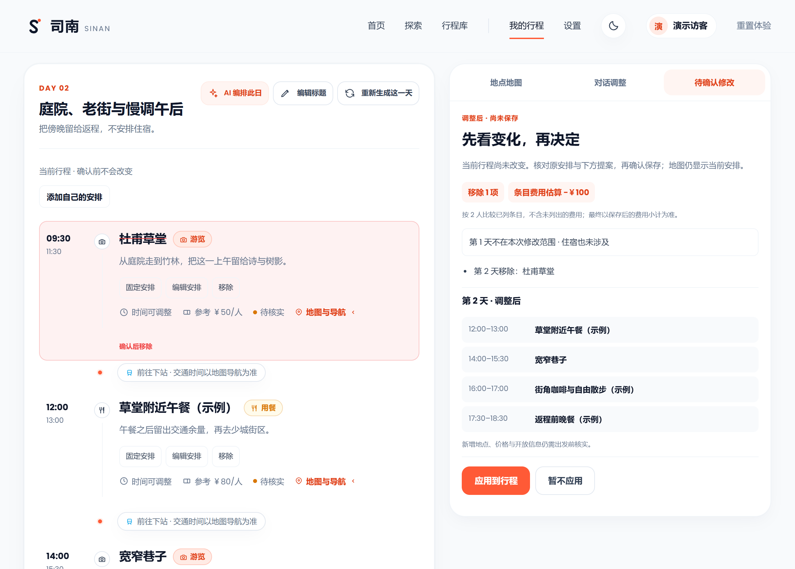
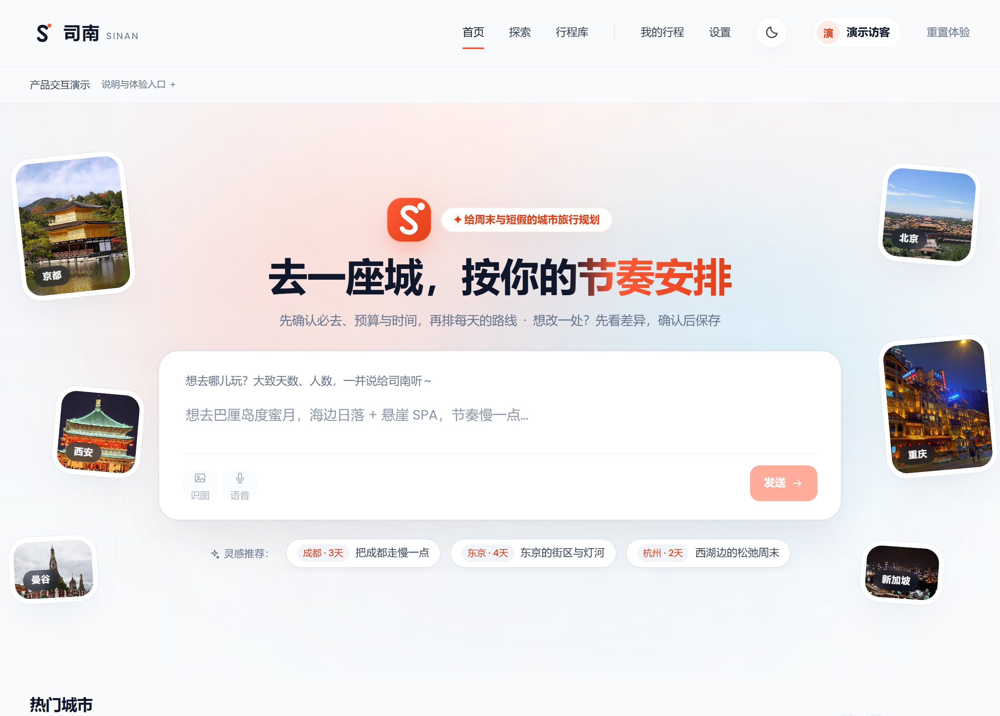
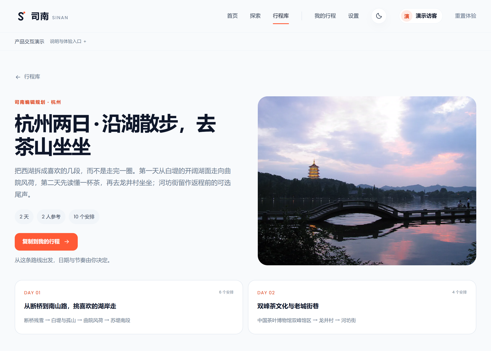
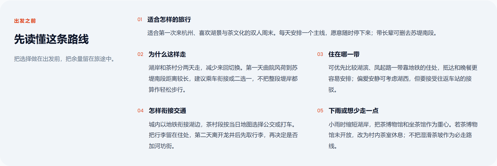
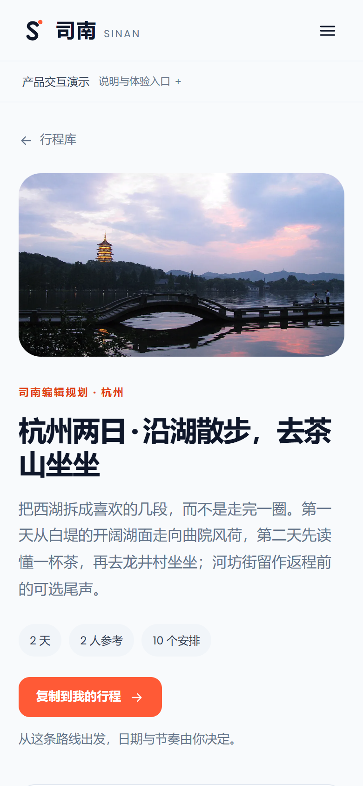
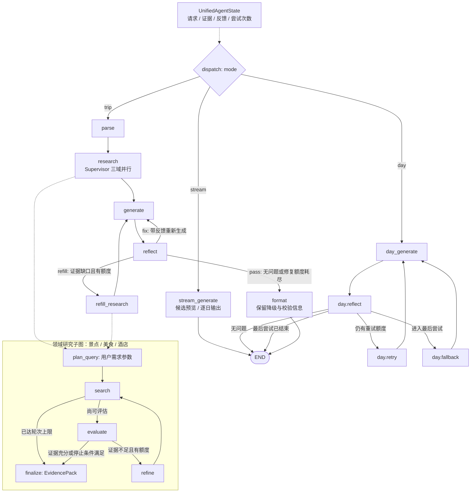
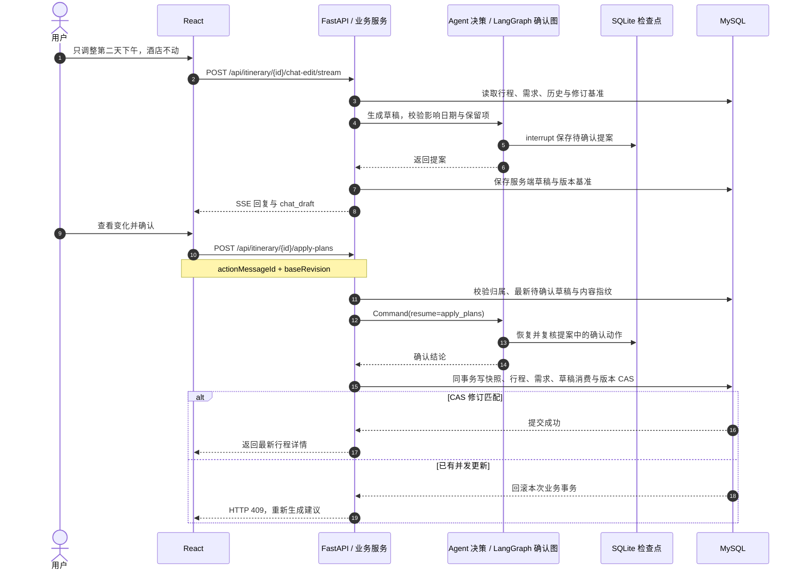
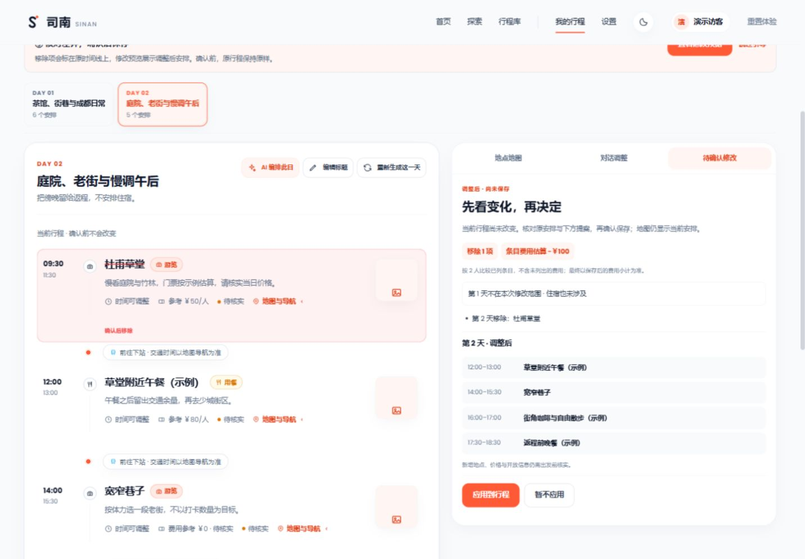
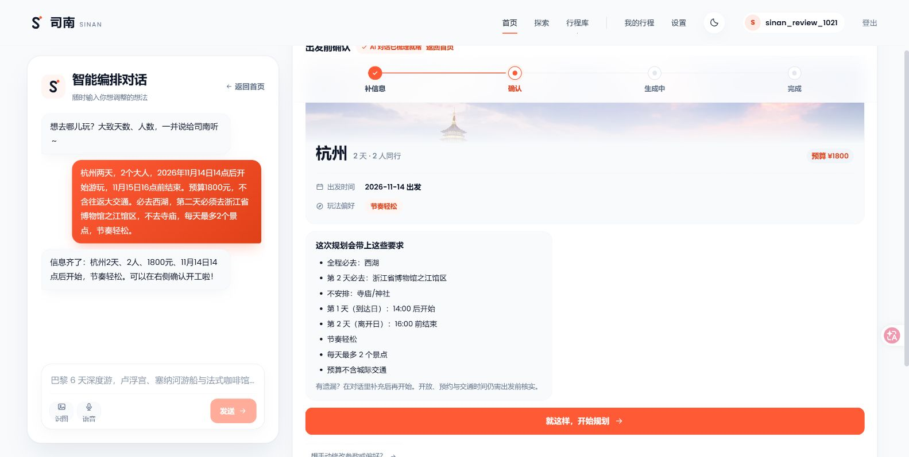

# 司南 Sinan · AI 旅行规划助手

**把周末想去的地方，排成一份能核对、能继续修改的行程。**

面向国内单城 2–3 日周末与短假：先确认必去地点、预算与到离时间，再生成每日安排；想改一处，先看差异，确认后保存。


[立即体验](https://sinan-demo.vercel.app) · [真实运行案例](docs/public/product-case-20261021.md) · [系统架构](docs/public/architecture.md) · [本地启动](#quick-start) · [English](README.en.md)

> 在线演示免登录，使用固定合成样例，不调用模型；真实模型运行与失败记录见案例。当前未开放公网真实模型试用。开放、预约、价格和交通仍需出发前核实。

[](https://sinan-demo.vercel.app)

*局部修改工作台 · 原时间线与修改提案并排核对，第一天和住宿保留。截图为固定合成样例。*

## 先花 90 秒，试一次修改

1. 打开[在线演示](https://sinan-demo.vercel.app)，点击“90秒体验局部修改”，进入独立的成都两日样例。
2. 按引导查看第二天的调整：原时间线标出移除项，右侧显示修改后的安排和可比较的费用变化。
3. 确认保存，再切换日期、刷新页面，核对保留的安排。也可以跳过引导自由浏览。

修改只保存在当前标签页。这个入口展示交互，不把预设回复当作真实模型生成。

## 三个值得看的场景

| 场景 | 用户能观察到的行为 | 从哪里看 |
| --- | --- | --- |
| 要求很多，先说清楚再生成 | 必去日、排除项、时间窗与预算先确认；生成后校验，违规日期单独重试，未完成明确提示 | [真实模型案例与失败过程](docs/public/product-case-20261021.md) |
| 只改第二天，其他安排保留 | 先展示差异，确认后保存；服务端校验修改范围和版本，旧草稿不能覆盖新行程 | [公开交互演示](https://sinan-demo.vercel.app) |
| 返程提前，需要取舍 | 固定不能动的安排，比较保留全部与舍弃可选项；冲突方案不可应用，选择后仍需确认 | [固定样例与计算边界](docs/public/vercel-demo.md#时间取舍与恢复) |

这些是可观察的产品能力，不是规划质量优于通用模型的对照结论。首版聚焦单城短途，不承担订票与导航；地图点位连线不等于真实交通路线。

### 从一句话，到一份自己的路线

[](https://sinan-demo.vercel.app)

*先确认需求，再安排每天。下方的目的地与路线灵感可直接浏览。*

[](https://sinan-demo.vercel.app/itineraries/-1)

*七条编辑规划，包含路线取舍、住宿选区、交通衔接与雨天建议。打开后可复制成自己的行程。*

<details>
<summary>展开查看：行前指南与手机端</summary>



<p align="center"></p>

</details>

截图直接采自真实页面，使用固定样例，2 倍像素 PNG。

## 从体验找到实现

| 想了解什么 | 入口 |
| --- | --- |
| 系统如何拆分，产品实际走哪条链路 | [系统架构](docs/public/architecture.md) · 下方[生成与确认工作流](#architecture-workflows) |
| 真实模型跑过什么，失败后怎样处理 | [产品验收案例](docs/public/product-case-20261021.md) |
| 演示哪些是真的交互，哪些是固定内容 | [演示说明与截图](docs/public/vercel-demo.md) |
| 如何运行、修改与参与 | [本地启动](#quick-start) · [开发说明](docs/public/development.md) · [贡献指南](.github/CONTRIBUTING.md) |

真实应用还支持[公开行程库与复制微调](docs/public/public-itineraries.md)、条目编辑与撤销、历史版本恢复、分享和中文 PDF 导出；[天气照看与显式偏好记忆](docs/public/care-and-memory.md)有独立说明。具体开放范围以各功能文档为准。

## 1. 核心痛点与架构亮点（Key Features & Technical Highlights）

| 业务难点 | 实现机制 | 核心源码 |
| --- | --- | --- |
| 一次检索难以覆盖景点、美食与住宿，证据不足时容易凭空补齐 | Supervisor 用线程池并行派发三域 LangGraph 研究子图；域内沿用需求参数直接检索 → 充分性评估 → 缺口关键词补查；查询参数不额外调用模型。Agent API 的 trip 分支还可按已识别的景点证据缺口定向重派研究 | [研究编排](travel-agent-python/app/agent/research/supervisor.py)、[研究子图](travel-agent-python/app/agent/research/factory.py)、[补查路由](travel-agent-python/app/agent/generation/orchestration/graph_nodes.py) |
| 长 JSON 必须等完整响应才能显示，备选富化拖长主流程 | ijson 增量解析完整条目，经 SSE 发布可撤回的候选；逐日结果落库后终检，全部日期交付后发布 `core_ready`；主流程收尾后异步补充备选与介绍 | [增量解析器](travel-agent-python/app/agent/generation/content/incremental_plans.py)、[流式分支](travel-agent-python/app/agent/generation/orchestration/stream_branch.py)、[业务交付](travel-agent-python/app/services/itinerary_generation.py) |
| “只改第二天”可能误改其他日期，旧建议可能覆盖新行程 | 草稿阶段逐字段校验修改范围与保留项；LangGraph `interrupt` 等待确认；应用时只读服务端草稿，校验内容指纹及整数修订号，快照、写入与草稿消费在同一事务内完成 | [范围校验](travel-agent-python/app/agent/editing/chat_draft/validate.py)、[HITL 确认图](travel-agent-python/app/agent/editing/chat_draft/confirm_graph.py)、[事务应用](travel-agent-python/app/services/itinerary_plan_apply.py) |
| 模型排程可能违反必去、排除、时间窗、去重与预算要求 | 共享确定性约束与单日交付规则；业务层终检后仅重置违规日期，用反馈驱动单日图重新生成；保留已成功日期，未完成显式收敛为 `PARTIAL` / `FAILED` | [约束规则](travel-agent-python/app/agent/generation/rules/constraint_checks.py)、[交付门](travel-agent-python/app/services/day_delivery_gate.py)、[单日修复图](travel-agent-python/app/agent/generation/orchestration/trip_graph.py) |

工程边界：FastAPI 承载业务与 Agent API，独立规划 worker 从 MySQL 领取整趟规划并复用 `plan_days`；MySQL 保存业务数据、任务与有界 SSE 回放，SQLite 保存 LangGraph 检查点，Redis 承担缓存、会话吊销等辅助职责。地点事实来自模型知识与外部数据适配器，未证实字段保留估算/待核实标记；本地不维护景点向量语料库。

<a id="architecture-workflows"></a>

## 2. 系统架构与工作流（System Architecture & Workflow）

### 图 1：统一生成状态机与研究子图

以下节点名对应 [trip_graph.py](travel-agent-python/app/agent/generation/orchestration/trip_graph.py) 与 [factory.py](travel-agent-python/app/agent/research/factory.py)。`UnifiedAgentState` 是共享状态定义；三域并行发生在 Supervisor 线程池，各域内部执行下方研究子图。



**产品实际调用顺序**：业务层 `plan_days` 先研究，再调用 `mode=stream`，对落库结果终检，将违规/缺失日期交给 `mode=day` 补齐，随后发布主行程里程碑并提交后台富化。`mode=trip` 服务 Agent API，不应与前端主路径混为一条链路。`day.fallback` 是最后一次带反馈的模型尝试；`run_day` 返回前仍检查硬交付条件，不合格就抛错。

### 图 2：自然语言局部编辑与确认



图中的确认图与 MySQL 事务各自持久化；业务写入的最终有效性由服务端草稿与数据库 CAS 保证。兼容旧消息或检查点已清理时，仍执行消息级版本校验。此机制描述 `/chat-edit` → `/apply-plans` 确认流；另有直接写入的 `/nl-edit` 接口，行为边界见 [服务实现](travel-agent-python/app/services/itinerary_nl_edit.py)。

## 3. 核心代码实现剖析（Under the Hood）

### 完整对象先成为候选，权威结果再替换预览

[TripPlanStreamParser](travel-agent-python/app/agent/generation/content/incremental_plans.py) 使用 ijson push 接口处理跨 chunk 字符串、转义与嵌套。下面是接口用法，`publish_preview` 为示意回调：

```python
parser = TripPlanStreamParser()
for delta in model_deltas:
    for candidate in parser.feed(delta):
        publish_preview(candidate)  # 条目已闭合、基础形状合法、归属日期已确定
plans, suggestions, seen_days = parser.finish()  # 截断 JSON 显式抛错
```

基础形状合法不等于最终可交付。候选以 `runId + dayNo + itemOrdinal` 标识；失败时发送撤回事件，正式日结果经落地与落库形成权威内容。`core_ready` 要求没有未完成日期；[后台富化](travel-agent-python/app/services/itinerary_enricher.py) 绑定提交时的规划修订，防止迟到结果覆盖用户的新编辑。[SSE 读模型](travel-agent-python/app/services/itinerary_events.py) 支持有界事件回放、`resync` 与终态补帧。

### 内容指纹挡旧草稿，数据库 CAS 挡并发写

[require_pending_action](travel-agent-python/app/services/itinerary_chat.py) 校验消息归属、最新草稿和内容指纹；[apply_plans](travel-agent-python/app/services/itinerary_plan_apply.py) 只从该消息取回方案，不信任客户端自带的行程。最后通过 [版本 CAS](travel-agent-python/app/services/itinerary_version.py) 封住“读后又被修改”的窗口：

```sql
-- 机制示意：同一业务事务内，条目写入、快照与草稿消费均先完成。
UPDATE itinerary_main
SET planning_revision = planning_revision + 1
WHERE id = :itinerary_id AND planning_revision = :expected;
-- 影响行数为 0：抛出 409，整个事务回滚。
```

修改范围在 [草稿生成阶段](travel-agent-python/app/agent/editing/chat_draft/validate.py) 按日期和条目字段校验。落库采用整份替换，所以局部编辑草稿必须携带未修改日期，不能只提交改变的那一天。

### 图内反馈与落库交付门共用规则

[UnifiedAgentState](travel-agent-python/app/agent/research/agent_state.py) 集中承载请求、证据、反馈与计数；[单日图](travel-agent-python/app/agent/generation/orchestration/trip_graph.py) 与 [业务交付门](travel-agent-python/app/services/day_delivery_gate.py) 复用硬规则，避免图内通过、落库时却用另一套判据。

```text
整趟流式结果 → 落库终检
  ├─ 合规日期：保留
  └─ 违规日期：重置 PENDING → 单日生成 → 规则校验 → 反馈重试
                                              └─ 仍不可交付：显式失败
已完成日期全部可交付 → core_ready → 主流程收尾 → 后台富化
中途失败且已有成功日期 → PARTIAL；没有可交付日期 → FAILED
```

[WorkingMemory](travel-agent-python/app/agent/runtime/memory/working.py) 保存本次已用地点、酒店与反馈；[RunLimits](travel-agent-python/app/agent/runtime/run_limits.py) 在研究、生成和修复间共享费用相关调用预算与 deadline，避免每进入一个节点就重新获得一份额度。

## 4. 效果演示与评测验证（Demo & Evaluation）

### 演示材料

[立即体验固定样例](https://sinan-demo.vercel.app)：成都两天一晚，免登录、不调用真实模型；交互数据仅保存在当前标签页。点击“90秒体验局部修改”，从独立样例开始，查看第二天、提出调整、核对差异后保存；可以随时跳过引导。

详情页在桌面并排展示时间线与地图／对话／修改预览，手机通过视图切换保留日期与草稿。确认前在原时间线上标出移除或调整项，同时展示提案、未涉及日期与可比较的费用变化；缺价、外币或住宿变化不推算节省额。交互及边界见 [展示说明](docs/public/vercel-demo.md)。



独立 worker 的投递、繁忙恢复、过载拒绝和本地假模型 HTTP 负载实验见 [执行说明](docs/public/planning-worker.md)。实验使用真实进程和 MySQL、固定研究策略与模型内容，保留失败及对照参数；不代表真实模型效果或线上容量。

本地真实模型的浏览器验收记录见 [2026-10-21 产品案例](docs/public/product-case-20261021.md)。案例保留两次部分交付、失败重试及修复后重新生成的过程，区分候选、落库和最终交付；它是小样本功能验收，不用于宣称成功率或性能提升。



固定样例展示交互，真实案例来自独立测试账号；当前没有对外开放的真实模型试用入口。录屏与多标签页冲突的浏览器演示尚未制作。

### 已入仓的离线评测基线

下表是 [metrics_baseline.json](travel-agent-python/tests/agent_eval/metrics_baseline.json) 登记的验收界值，**不是本次重跑结果，也不是线上模型质量指标**。默认 [产品路径评测](travel-agent-python/tests/agent_eval/eval_agent.py) 在临时 SQLite 上运行真实业务编排，外部检索与 LLM 使用固定 fixture / mock；[题集](travel-agent-python/tests/agent_eval/cases.json) 含 13 个场景。

| 检查项 | 入仓基线 | 解释与边界 |
| --- | --- | --- |
| 完整交付终态 `success_status_rate` | 0.9231，约 12/13 | 按落库读回的 `COMPLETED` 计数；不是用户满意度 |
| 部分交付终态 `degraded_status_rate` | 0.0769，约 1/13 | 三亚 5 日 fixture 末日补齐不足，保留成功日期并标 `PARTIAL` |
| 硬失败终态 `failed_status_rate` | 0 | 与部分交付分开计，不把 `PARTIAL` 并入完整成功 |
| 时间冲突 / 跨日景点重复 / 预算偏差率 | 各上限 0 | 固定输入、规则及估算费用口径，不验证真实营业时间或消费 |
| 终态复检重置日比例 `terminal_reset_day_rate` | 上限 0.0154 | 按日期计，不能把比例直接换成整趟修复成功率 |

### 可定位的行为回归

| 场景 | 断言关注点 | 现有测试 |
| --- | --- | --- |
| JSON 按单字符切块、包含转义、日期号后置、输出截断 | 只发布完整且归属确定的候选；失败撤回或有界修复 | [test_m5a_preview.py](travel-agent-python/tests/test_m5a_preview.py) |
| 主行程完成但后台富化仍在运行 | 未完成日期抑制 `core_ready`；旧修订的富化写入被拒绝 | [test_m5b_core_ready.py](travel-agent-python/tests/test_m5b_core_ready.py) |
| 提案暂停、恢复、重复确认及非法选择 | 暂停态可恢复，确认必须匹配提案 | [test_confirm_flow.py](travel-agent-python/tests/test_confirm_flow.py) |
| 局部编辑、保留项、越界修改 | 未请求日期及保留内容不应被模型改写 | [test_chat_draft_safety.py](travel-agent-python/tests/test_chat_draft_safety.py) |

真实模型效果与浏览器可见提前量需按 [证据采集协议](docs/public/development.md#生成证据采集与回放探针) 另外测量；当前 README 不填写尚未核验的修复率或性能提升百分比。日常验证入口见下文，完整 CI 保留类型、分层、规模、契约漂移、秘密扫描、离线测试、评测棘轮及前端验证。

## 5. 项目目录结构（Project Structure）

```text
Sinan/
├── travel-agent-python/              # 唯一后端；Python 3.12 + uv
│   ├── main.py                       # FastAPI 启动、生命周期与定时任务
│   ├── app/
│   │   ├── api/                      # 业务 API 与 Agent API 的鉴权、入参和响应
│   │   ├── services/                 # 任务、事务、归属与交付状态
│   │   │   ├── itinerary_generation.py # 研究、整趟流式、终检及逐日补齐
│   │   │   └── itinerary_plan_apply.py # 服务端草稿确认、写入与版本 CAS
│   │   ├── agent/
│   │   │   ├── core/                 # JSON、地理与点位身份等基础原语
│   │   │   ├── runtime/              # 检查点、轨迹、工作记忆与运行预算
│   │   │   ├── data/                 # 外部事实适配器与城市级数据
│   │   │   ├── grounding/            # 存在性、字段证据与溯源标记
│   │   │   ├── tools/registry/       # 工具声明、参数校验与受控派发
│   │   │   ├── research/             # Supervisor、领域子图、共享 State
│   │   │   ├── generation/           # rules / content / output / orchestration
│   │   │   └── editing/chat_draft/   # 对话草稿、范围校验与确认图
│   │   ├── schemas/                  # 跨端模型与事件契约的单一源
│   │   └── db/migrations/sql/        # 只追加的版本化 SQL 迁移
│   ├── tests/agent_eval/             # 离线题集、评测入口与指标基线
│   ├── .env.example                  # 完整后端配置模板，与 Settings 机检对齐
│   └── pyproject.toml / uv.lock       # 直接依赖、工具规则与解析后的依赖锁
├── travel-frontend-react/
│   ├── src/react-app/                # React 19 对话、行程、地图与确认界面
│   ├── src/types/generated/          # 从后端 schema 导出的类型，禁止手改
│   ├── e2e/                          # 固定样例回放与真实链路探针
│   └── package.json / package-lock.json # 前端脚本、依赖及锁文件
├── contracts/                        # 生成的 JSON Schema / OpenAPI
├── docs/public/                      # 公开架构、配置、开发与排障文档
├── deploy/                           # Railway 与自托管部署入口
├── scripts/                          # 开发、增量验证与密钥扫描
├── .github/workflows/                # CI 门禁与回放验证
├── .env.compose.example              # Compose 插值模板，非后端配置副本
├── compose.setup.yml                 # 不覆盖已有配置的随机口令初始化
├── docker-compose.yml                # 本地 MySQL / Redis / 应用栈
└── verify.ps1                        # 日常按改动范围验证入口
```

分层由 import-linter 约束：`api → services → agent`，业务层只经 Agent 门面调用；Agent 域与生成子层的依赖方向见 [域地图](travel-agent-python/app/agent/README.md)。修改 `app/schemas/` 后运行契约导出并一并提交产物；数据库只追加新迁移。

<a id="quick-start"></a>

## 6. 快速开始（Quick Start）

### 配置与依赖约定

- 完整后端变量在 [travel-agent-python/.env.example](travel-agent-python/.env.example)，唯一代码定义在 [Settings](travel-agent-python/app/common/config.py)。根 [.env.compose.example](.env.compose.example) 仅供 Compose 插值；[前端模板](travel-frontend-react/.env.example) 只包含公开构建开关，任何 `VITE_` 变量都不能放模型密钥。
- 初始化器生成随机数据库口令、JWT 与内部令牌；模型 key 留空。真实规划需配置模型通道、模型名与 key，联网研究还需支持搜索能力的通道，详见 [配置指南](docs/public/configuration.md)。费用与地理事实可能是估算，出发前应核实。
- 后端以 `pyproject.toml + uv.lock` 为准，前端以 `package.json + package-lock.json` 为准；使用 `uv sync --frozen` / `npm ci`。不再维护另一份 `requirements.txt`。Docker 使用多阶段构建，运行时注入秘密；后端运行镜像不安装开发依赖。
- 日志、缓存、运行报告、本地数据库、私钥和本地 `.env*` 不入仓；配置模板与无密钥的 `.env.demo` 保留。安全问题按 [安全政策](.github/SECURITY.md) 私密报告。

### 在线与本地入口

打开 [在线演示](https://sinan-demo.vercel.app)，无需安装、登录或模型 Key。
演示复用正式页面，以成都两天一晚的合成固定样例体验规划、地图和编辑确认；不调用 AI。
交互数据只保存在当前标签页，刷新可续、重置可清除。地图底图需要联网，失败时仍可查看行程与导航深链。

| 你的目标 | 入口 | 需要准备 |
| --- | --- | --- |
| 只看产品交互 | [在线演示](https://sinan-demo.vercel.app) | 浏览器 |
| 在本机体验固定样例 | [仅前端演示](#仅前端演示) | Node 22.12+ |
| 运行完整应用、使用真实规划 | [完整本地运行](#完整本地运行) | Docker；真实规划另需模型 Key |
| 修改代码 | [开发指南](docs/public/development.md) | Python 3.12、uv、Node 22.12+、Docker |

### 获取代码

```bash
git clone https://github.com/wabcyyyy/Sinan.git
cd Sinan
```

以下两种本地方案任选其一，各自从仓库根目录开始。

### 仅前端演示

准备 Node 22.12+，执行：

```bash
cd travel-frontend-react
npm ci
npm run dev
```

打开终端给出的地址并访问 `/demo`（默认 [localhost:5173/demo](http://localhost:5173/demo)）。
固定演示无需 Python、数据库或模型 Key；普通首页的真实规划需要后端。按 Ctrl+C 停止开发服务器。
静态展示构建与发布见 [Vercel 展示说明](docs/public/vercel-demo.md)。

### 完整本地运行

准备 Docker Engine/Desktop 与 Compose 2.20+。本方案启动 MySQL、Redis、FastAPI、规划 worker 和前端；不需要在宿主机安装 Python 或 Node。
在仓库根目录执行：

```bash
docker compose -f compose.setup.yml run --rm setup
docker compose --profile apps up -d --build --wait --wait-timeout 300
```

启动后打开 [固定演示](http://localhost:5173/demo)。首次构建需要联网下载镜像和依赖。
初始化会生成数据库口令、JWT 与内部令牌，模型 key 默认留空；已有配置与数据不会被覆盖。
真实规划按 [配置指南](docs/public/configuration.md) 填写模型信息并重新创建后端容器，然后打开 [首页](http://localhost:5173/) 注册、登录。
启动失败先看 [排障指南](docs/public/troubleshooting.md)，运行：

```bash
docker compose exec -T agent-python python scripts/preview_doctor.py
```

停止本项目的容器并保留数据：`docker compose --profile apps stop`。
需要切换到宿主机开发时，按 [开发指南](docs/public/development.md) 停止应用容器，只保留数据库。

### 本地开发与贡献

开发环境为 Python 3.12 + uv、Node 22.12+；CI 与容器使用 Node 22，依赖由锁文件安装。
初始化后，只保留数据库容器运行：

```bash
# 仓库根目录
docker compose --profile apps stop agent-python frontend-react
docker compose up -d --wait mysql redis
```

分别在两个终端启动后端与前端：

```bash
# 终端一，从仓库根开始；本机 HTTP 的后端配置须设 AUTH_COOKIE_SECURE=false
cd travel-agent-python
uv sync --frozen
uv run python main.py
```

```bash
# 终端二，从仓库根开始
cd travel-frontend-react
npm ci
npm run dev
```

日常验证在仓库根按平台任选一个入口执行，按改动选择静态检查与相关测试：

```powershell
# Windows
.\verify.ps1
```

```bash
# Linux / macOS
uv run --project travel-agent-python python scripts/ai_validate.py --run
```

全量回归与离线评测由 CI 执行；日常规则见 [VALIDATION.md](VALIDATION.md)，点名测试、契约导出与评测命令见 [开发指南](docs/public/development.md)。
欢迎可复现 Bug、文档修正与小范围改进，流程见 [贡献指南](.github/CONTRIBUTING.md)。

### 部署自己的实例

- [Vercel 静态展示](docs/public/vercel-demo.md)：仅前端固定样例，无需后端或模型 Key。
- [Railway 完整应用](docs/public/production.md)：单实例、持久卷、邀请码和试用额度管理。
- [Caddy 自托管](deploy/README.md)：单机 Compose 与 HTTPS 反向代理。

完整应用的公网可用性与真实模型质量需在自己的部署环境验证。

### 许可与安全

自身代码与文档使用 [MIT](LICENSE)。图片、字体与依赖使用各自许可，详见 [第三方资源](THIRD_PARTY_NOTICES.md)。
安全漏洞请按 [安全政策](.github/SECURITY.md) 私密报告，不要在公开 Issue 放置漏洞细节或凭据。
当前为开源预览阶段，尚无长期支持版本承诺。版本化镜像与正式 Release 不属于本批交付。
