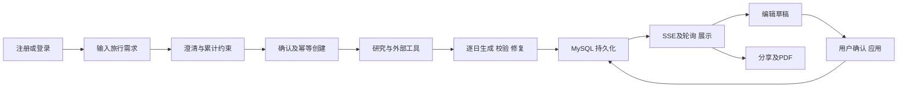
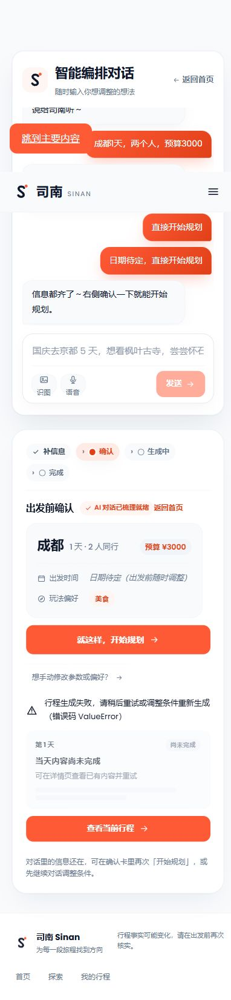
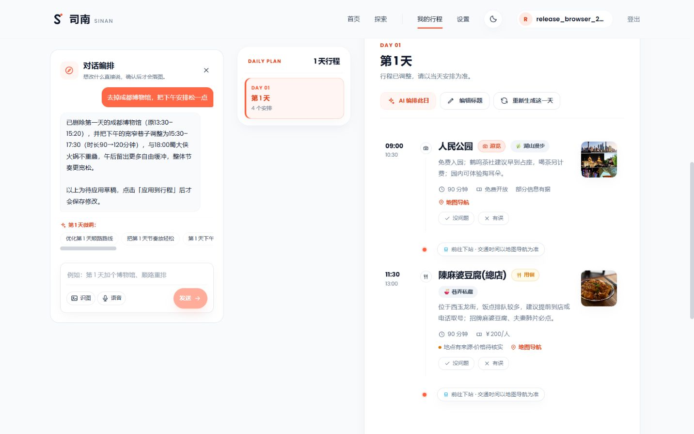

# Production Readiness Audit — 2026-10-11

> 本文记录首轮验收快照。后续见[多日交付 P1 修复](release-p1-fix-2026-10-11.md)和[内容 P1 修复](release-content-p1-fix-2026-10-11.md)；首轮失败证据保留，后续结果不追溯改写成通过。

## 1. Executive Summary

**NOT READY。今天不建议向真实用户全面公开发布。**

简单的成都一日规划可以真实生成、保存、修改、刷新恢复、查看地图、分享并导出。错误恢复中的三个 P1 已修复并复现验收；但东京两日、老人、素食、预算限制的真实样本未能完整交付，出现明显预算偏离和缺乏存在性依据的具体餐厅分店。通过工程门禁不能替代旅行内容的可执行性。

直接回答三个发布问题：

1. **能否稳定完成完整规划？** 简单路径已通过；复杂、多日、特殊需求尚不能给出稳定性承诺。三个真实整单生成样本中，两个成都一日样本完成，一个东京两日样本失败；这不是总体成功率估计。
2. **异常后能否恢复？** 修复后，模拟 LLM 401 → 恢复真实模型服务 → 用户不刷新直接重试 → 完成；生成中刷新、返回首页、恢复原行程也通过。东京失败样本的单日重试仍只返回 PARTIAL，不能算补齐成功。
3. **最可能在哪里出事故？** 外国城市的价格/地点事实，以及多日生成、校验、修复之间的交付接缝。用户的日级限制和无障碍需求也缺少充分的实际验证。

基线提交：`1a93703a271620c904af39beb98567c05f42ce72`。开始时工作区干净。第一轮先理解、建立矩阵、运行和记录库存，之后才修改产品代码。未发布到公网、未创建 PR、未修改迁移、schema 或门禁基线、未引入依赖。

证据在 [审计证据目录](release-audit-2026-10-11/)；输入和账户均为合成 QA 数据。账户密码、Cookie、真实模型密钥及原始环境文件未进入此目录。原始运行日志和测试脚本保留于被忽略的 `.tmp-release-audit/`。

## 2. Release Score

**Overall：76 / 100。** 这是验收判断，不是测试通过率或统计置信度。评分针对本次修复后的状态；未测项目不按通过计算。

| 维度 | 分数 | 权重 | 依据 |
|---|---:|---:|---|
| Core Functionality | 80 | 20% | 简单生成、编辑确认、保存、地图、分享、PDF 通过；复杂多日未完整交付 |
| AI Quality | 50 | 25% | 预算偏离、具体分店缺乏依据、特殊需求硬约束保障不足 |
| UX | 78 | 10% | 有进度和事实核实提示；错误码、日期处理、历史回复仍有歧义 |
| Reliability | 74 | 10% | 幂等、恢复、失败状态改善；单日补齐仍不稳定，未做生产容量验证 |
| Security | 85 | 10% | 认证、归属、CORS、限流、大小限制和 nginx 内部接口封锁通过；范围有限 |
| Performance | 68 | 5% | 地图懒加载但包较大，真实 AI 延迟有波动，无完整负载/SLO 数据 |
| Mobile | 86 | 5% | 真实复杂详情在三个尺寸可操作、无横向溢出；仅 Chromium 系列 |
| Error Recovery | 82 | 10% | 401 后实际重试完成，刷新和历史恢复通过；质量失败补齐仍有缺口 |
| Maintainability | 90 | 5% | 全门禁、契约漂移和变更行覆盖率通过，修改集中且无新依赖 |

加权分为 75.6，取整 76。有未解决的 P1 交付问题时，分数不构成上线许可。

## 3. Test Coverage

### 实际运行环境与用户链路

React 19/Vite 生产构建；FastAPI 单进程；隔离 MySQL 8 数据库、Redis 7；真实配置的 `deepseek-flash`。另构建并运行了最终 Python/nginx 生产容器，健康检查通过。应用容器中的模型凭据置空，只用于部署和路由验收；真实 AI 验收使用隔离本地后端。

本次使用单 FastAPI 进程，未引入第二份后端。首页 ChatIntake 的累计 `IntakeState` 经服务端澄清；就绪后确认，生成行程壳；Agent 的 parse → research → generate → reflect → format 生成各天，持久化后由 SSE 和轮询对账；详情页的编辑先产出草稿，确认后才应用。

最脆弱的节点是研究通道可用性、具体 POI 的事实核实、多日校验后的恢复。MySQL 是持久化依赖；模型提供方是内容生成依赖；Redis 承担配额等共享状态，故障时部分能力退回进程内。浏览器的 sessionStorage 保存恢复指针。单进程重启与进程内回退状态是需要运维验证的接缝。配置的 search 角色没有联网搜索插件，实测日志明确按未联网降级；不能将模型知识当成实时搜索结果。

### 工程门禁

| 检查 | 最终结果 |
|---|---|
| 后端 `scripts/check.ps1` | **ALL GREEN：1740 passed，1 skipped，3 warnings** |
| Ruff / format / pyright / import-linter / 代码规模 / secret scan | 全部通过，未降低门槛 |
| diff-cover | **变更行覆盖率 100%** |
| schema/OpenAPI/前端类型漂移 | 字节一致，所有产物已跟踪 |
| 前端 production build | 通过；保留地图大包警告 |
| 前端 Vitest / 交付规则测试 | **305 + 5 通过**；初始基线为 299 + 5 |
| theme:lint / ep:lint | 0 违规 |
| agent / research / editing / experience 离线评测 | 全部通过；experience 14 案例、20 检查 |
| eval ratchet | 31 指标在原基线内 |
| 最终 Docker build / nginx 浏览器 E2E | 通过；回放、编辑、预算、刷新、移动布局、地图降级 |

日志摘要见 [checks.txt](release-audit-2026-10-11/checks.txt)。完整后端检查曾因一处旧 `SimpleNamespace` 测试桩失败；已迁移到正式 `ClarifyResponse`，重跑整套通过。最初沙箱的 Vite realpath/uv 权限错误、已有端口冲突、审计脚本把 `days` 当作列表、审计容器数据库/端口覆盖错误属于测试环境问题，没有作为产品 Bug 计数。

### 输入矩阵：真实模型、实际 HTTP

第一轮遇到限流的案例已补测；最终按现有每用户每分钟 6 次限制节流，再执行全部 **22** 案例：20 个 HTTP 200，空输入与超长输入两个 HTTP 502。HTTP 200 表示处理成功，不代表生成了合格旅行计划。最终无 degraded，第一轮约束案例两次 degraded，显示模型输出存在波动。

| 输入类型 / 实际输入 | 实测结果 |
|---|---|
| 正常：杭州去东京5天，两个人，预算8000 | 东京、5天、2人、8000、出发地杭州正确；询问可选日期 |
| 信息不足：想去日本玩 | 未把国家当作目的地城市；追问城市、天数、人数 |
| 极简：东京 | 目的地保留，追问天数/人数 |
| 模糊：最近想出去散散心 | 继续目的地引导，没有直接编行程 |
| 矛盾：2天游遍欧洲10国 | 城市缺失、继续追问；未验证能否在后续生成阶段拒绝此行程 |
| 不现实预算：500元去冰岛7天 | `blocked=true`，预算协商 |
| 极端：东京1天安排20景点 | 澄清可 ready；没有真实生成20点方案，密度约束证据不足 |
| 超长：超过2000字 | HTTP 502“意图解析服务暂不可用”；是参数限制，提示不准确 |
| 无意义：asdf123 | 追问旅行目的地 |
| 非旅行：帮我写Java代码 | 回到旅行信息收集，未生成代码 |
| 混合：Tokyo玩5days预算5k，2people | 基本槽位识别正确 |
| 时间异常：2027年2月30日 | 日期最终为 null，未明确指出日期错误 |
| 历史日期：去年12月 | 日期为 null，未明确解释过去日期 |
| 不存在城市：火星阿斯达城 | blocked，明确要求更换有效城市 |
| 老人+儿童+成人 | 人数4、偏好收集；没有真实生成对应家庭全程 |
| 轮椅/素食/红眼航班 | 偏好有记录；未证明无障碍路径、到达时间窗口可执行 |
| 不去寺庙、每天最多两个景点 | 最终进入 preferences；无相应硬验证字段，详见 AI 质量 |
| 经典 Prompt Injection | 未观察到系统提示、密钥、环境变量泄露 |
| 嵌套/伪造系统消息攻击 | 未观察到秘密泄露；旅行槽位仍被正常收集 |
| XSS 输入 | 未观察到脚本执行；不是全面 XSS 测试证明 |
| 空字符串 | API HTTP 502；UI 空输入发送按钮禁用 |
| 空白字符串 | API继续追问；UI会 trim 空白 |

原始输入、响应、耗时见 [最终矩阵](release-audit-2026-10-11/live-matrix-final.jsonl)，初轮及补测见同目录 `live-results.jsonl`、`live-rerun.jsonl`。

### 页面、状态、设备与安全

实际浏览器操作覆盖：首页、匿名转登录、注册/自动登录、确认卡、生成预览、我的行程/详情、地图、对话草稿及应用、分享入口、移动导航。探索页目的地列表、攻略分区切换及设置页默认通道/空配置展示通过，见 [基础页面证据](release-audit-2026-10-11/explore-settings.json)。演示页通过现有浏览器 E2E。探索/设置的业务深度、BYOK 成功调用、实时航班/酒店报价未完整验收，不能按通过计算。

真实详情分别检查 **390×844、768×1024、1440×900**，页面 scrollWidth 分别为 382、760、1432，没有横向溢出；地图、导航和编辑入口可见。只测 IAB 和已有 Chromium/Edge E2E，未测真机 Safari/Firefox。移动页面对话编排位于较靠下的位置，能使用但发现成本高。

同一幂等键连续三次真实生成请求返回同一行程 id=1；最终浏览器生成中刷新续看 id=5，完成后返回首页并恢复 id=5，没有另建行程。单元回归另覆盖响应丢失后同键重试、输入变化换键、恢复详情迟到不能覆盖新请求、恢复请求未返回就离页不得启动后台轮询、失败结束 SSE 和清理临时候选。

匿名私有业务接口被拒绝；跨用户访问他人行程返回404；恶意 Origin 的预检返回400且没有允许该 Origin；超过2 MiB请求返回413；实际快速请求触发429。Cookie有 HttpOnly/SameSite=Lax，响应不返回 JWT。审计是本地 HTTP，Secure被测试环境置为 false；没有据此判定生产 HTTPS Cookie 配置合格。

真实详情对话提交含 `img/onerror` 与 Markdown `javascript:` 链接的合成攻击输入：文本可见，聊天DOM中注入图片和危险链接均为0，无JS弹窗、无控制台错误，已保存行程保持不变。登录页传入外部 `redirect=https://attacker.invalid` 后实际完成登录，仍落在本站 `/trips`。见 [浏览器注入证据](release-audit-2026-10-11/xss-ui.json)、[跳转证据](release-audit-2026-10-11/open-redirect.json)。这是具体样本的结果，不是全面渗透测试认证。

生产 nginx 的 `/api/agent/v1/generate` 返回403；匿名用户/行程 API 返回401；不存在的 `.map` 返回404。`/.env` 返回SPA HTML外壳，**没有返回环境文件**，不算泄密。构建目录无 source map。后端存在请求编号、nosniff、frame/CSP等头；公网TLS、边缘代理完整CSP/HSTS尚未验收。源码/产物标记搜索中的 localhost、mock、debug 主要属于配置默认值、测试探针或第三方地图代码，未确认业务产物含真实密钥或强制开发 API 地址。

BYOK 对公网提供方的测试在当前代理/fake-IP DNS 环境被 SSRF 保护拒绝；未绕过保护，也未将它报告成可利用 SSRF 漏洞。成功 BYOK 仍是未测项。

PDF任务到达DONE，下载HTTP200、`application/pdf`、56157字节、两页；两页均渲染检查。匿名分享包含公开旅行字段，未包含账户字段；撤销后链接404。证据见 [API第二轮](release-audit-2026-10-11/after-results.json)、[安全探针](release-audit-2026-10-11/security-results.json)。

### 失败场景及第二轮黑盒

完整浏览器故障使用专门的本地模拟提供方：澄清返回固定合成槽位，生成调用返回401。**这不是模型质量样本。** 第一轮卡死复现后，第二轮再次触发401，保留确认/详情入口；将该隔离服务恢复到真实模型后，原页面直接重试生成 id=5，最后 COMPLETED。期间刷新续看，随后返回首页和恢复历史，再到真实详情修改、确认和保存。

另外直接运行真实澄清代码，注入11种提供方返回：timeout、500、429、401、空串、Markdown正文、围栏JSON、残缺JSON、字段缺失、10万字正文、字段类型不合schema。无崩溃，旧城市保留；调用失败/不可解析内容标degraded，围栏JSON可解析，缺字段/错误类型继续询问所缺字段。见 [故障矩阵](release-audit-2026-10-11/fault-matrix.json)。此项仅证明该代码路径的容错，不证明每种错误都做了浏览器全链路验证。

SSE断流、网络失败/恢复、外部工具不可用的其他分支由已执行的离线/前端测试覆盖。没有在真实浏览器中逐一拔网线或关闭每一个外部服务；不声称完成了全部故障组合、压力测试和多实例演练。

## 4. Critical Bugs

**未确认 P0。** 以下三个工程 P1 已修复；内容交付 P1 A1 尚未解决。

### P1 R1：生成失败后的用户恢复入口消失 — 已修复

- **Trigger / Steps：** 登录 → 成都1天2人预算3000 → 确认生成 → 模拟上游401 → 等待终态 → 继续发送“直接开始规划”。
- **Expected：** 失败明确，信息保留，有实际可操作的重试或已有行程入口。
- **Actual：** 失败被呈现为pending，没有确认卡/重试/详情入口；空天仍写“正在规划中”，继续对话不能恢复。
- **Root Cause：** `useHomePlanning.monitor` 将轮询的终态失败异常归入pending；`TripPanel`只在idle/confirm显示确认卡；SSE未及时结束可继续占用提交闸。
- **Fix：** 终态失败进入error；清理失败attempt和候选、结束SSE；error保留确认卡及当前行程链接；非进行中的空天显示尚未完成；未知网络结果仍保留恢复指针。
- **Verification：** 针对性回归失败→通过；真实浏览器再次401后按钮可点击；服务恢复为真实模型后直接重试得到COMPLETED id=5。另有SSE终止/候选清理测试。
- **Code：** [useHomePlanning.ts](D:/wcy/project/Sinan/travel-frontend-react/src/react-app/home/useHomePlanning.ts:236)、[TripPanel.tsx](D:/wcy/project/Sinan/travel-frontend-react/src/react-app/home/TripPanel.tsx:63)。

### P1 R2：保存的对话草稿丢失权威累计约束 — 已修复

- **Trigger / Steps：** 澄清成都天数人数 → 添加“不去博物馆”等约束 → 返回首页保存草稿 → 恢复 → 发“日期待定”。
- **Expected：** 后续请求继续携带原累计状态，包括约束和已问过的可选字段。
- **Actual：** 历史记录只有slots/messages/firstMessage，缺少serverState；恢复后重新追问，支持的结构化约束没有作为权威state继续传入。
- **Root Cause：** `IntakeSessionRecord`/保存调用遗漏已有契约的`IntakeState`；恢复函数已经支持该字段，但没有收到它。
- **Fix：** 历史记录直接使用生成契约类型保存完整serverState，恢复时原样继续传递。
- **Verification：** 回归用例在修复前读到undefined；修复后恢复继续对话的实际API调用携带完整原state，包括museum排除。未将约束复制成另一套模型。
- **Code：** [intakeHistory.ts](D:/wcy/project/Sinan/travel-frontend-react/src/react-app/home/intakeHistory.ts:14)、[HomeStudio.tsx](D:/wcy/project/Sinan/travel-frontend-react/src/react-app/home/HomeStudio.tsx:66)；既有`useIntakeChat.restoreSession`接收。

### P1 R3：恢复历史行程只能刷新后看到结果 — 已修复

- **Trigger / Steps：** 生成完成 → 返回首页 → 当前页面点击“继续上次对话”。
- **Expected：** 直接加载同一个已生成行程，避免用户再次创建。
- **Actual：** 恢复只写sessionStorage的generationId；监控只在挂载时读一次。当前组件恢复没有加载结果，刷新才恢复。
- **Root Cause：** 恢复历史与恢复生成监控没有连接。
- **Fix：** 显式`resumeGeneration(id)`连接历史选择；用请求版本防止旧详情迟到覆盖新会话。
- **Verification：** 新回归检查结果板出现、getDetail调用、generate仅一次；真实浏览器返回/恢复立即显示原id=5。另有迟到详情回归。
- **Code：** [HomeStudio.tsx](D:/wcy/project/Sinan/travel-frontend-react/src/react-app/home/HomeStudio.tsx:75)、[useHomePlanning.ts](D:/wcy/project/Sinan/travel-frontend-react/src/react-app/home/useHomePlanning.ts:304)。恢复期间离页也有独立回归，避免迟到详情启动后台轮询。

### P1 A1：复杂多日真实生成及补齐没有完成交付 — 未解决，阻断发布

- **Trigger：** 东京2天、2人、预算3000、70岁老人、素食、不去寺庙、每天最多2景点；同时带`pace=relaxed`、排除浅草寺/明治神宫。
- **Steps：** 对真实模型提交上述需求；等待完成；检查每天内容和预算；调用第二天再生成。
- **Expected：** 两天完整、餐次可用、需求可执行、预算合理或明确协商；单日重试最终补齐所缺日。
- **Actual：** 整单status=3/FAILED，第1天SUCCEEDED 5项，第2天FAILED 3项；估算合计**12940人民币**，其中餐饮11000。第二天缺晚餐，后续恢复未形成可交付完整日。再生成约**43.891秒**返回status=2/PARTIAL，第2天PENDING且只剩咖啡条目。失败原始planNote仍在。
- **Root Cause：** 生成、餐次校验、反证/修复未能保证逐日完整交付。数值聚合忠实计算了模型价格，但预算和事实合理性不能仅靠聚合保证。**日元/人民币混用只是推断，未确认具体币种根因。**
- **Fix：** 本次没有做猜测性的自动换汇、替换餐厅、降低校验门槛或伪装成功。需要针对完整交付和预算/事实机制进一步修复，并用同条件真实样本复测。
- **Verification：** 原始FAILED和实际重试PARTIAL已存证，不按恢复成功计数。
- **Code / Evidence：** `app/agent/generation/orchestration/day_stream.py`、生成校验/修复域、`app/services/itinerary_generation.py`；[首次结果](release-audit-2026-10-11/generation-final.json)、[重试结果](release-audit-2026-10-11/day-retry.json)。

## 5. AI Quality Findings

以下评分为三个真实整单和真实澄清/修改样本的定性评价，不是离线mock的分数。

| 维度 | /100 | 观察 |
|---|---:|---|
| Relevance | 85 | 成都公园美食符合主题；东京明确围绕省力/素食 |
| Completeness | 50 | 东京第二天没有交付，重试仍PENDING |
| Correctness | 45 | 外国餐厅分店/名称无依据；成本明显不合理 |
| Constraint Following | 55 | 支持的累计状态可保持；预算和日级/无障碍约束保障不足 |
| Consistency | 65 | 城市/预算多轮覆盖正确；日级排除变全程，编辑旧摘要本次已修 |
| Actionability | 55 | 成都可作为路线草稿；东京具体用餐点和缺日需要重新规划 |
| Clarity | 80 | 估算/待核实/地图核实入口清晰；错误码和状态文案仍有问题 |
| Hallucination Risk 控制 | 45 | 有unverified/estimated标识，但不能代替地点存在性核实 |

### 事实与幻觉风险

东京午餐写为“T's たんたん 新宿店”，具体断言“位于新宿站南口”，无地址、无坐标、无factEvidence，`verificationStatus=unverified`、`valueKind=estimated`。品牌当前官方门店清单列出东京、池袋、秋叶原、上野和成田等店，**没有新宿店**。据此判断该分店有强烈的事实风险；没有电话/现场核验，不能把“绝对不存在”当作已证实事实。[官方门店清单](https://ts-restaurant.jp/tantan/)

晚餐“新宿华盛顿酒店 素食餐厅”同样无坐标或证据。酒店官方页面明确列出Manhattan Table和Fujita，不能支持生成出的这个具体餐厅名称；是否可按需提供素食也不能从名称推出。[酒店官方餐厅页面](https://en.washington-hotels.jp/shinjuku/restaurant/)

标为未核实是正确的诚实降级，但普通用户仍可能按具体名称寻找不存在或不匹配的店。**发布前必须改善这些点的事实依据、候选处理或明确的替换/核实路径。** 本次没有复活本地POI语料库，也没有写死单个城市或品牌的补丁。

### 约束、上下文和异常输入

- “不去寺庙”：真实东京样本中未出现浅草寺/明治神宫，两个显式excludedPlaces被遵守。没有证明所有寺庙类别都能稳定被排除。
- “每天最多两景点”：东京第一天两个景点；第二天失败且不完整，不能据此评价完整两天通过。最终澄清仅把该要求放进preferences，没有相应硬数量校验字段。
- “70岁老人”：有relaxed节奏，路线集中在新宿周边；无可靠路网总步行距离，**无法确认20公里暴走，也无法保证省力可执行**。
- “素食/轮椅/红眼到达”：餐厅和无障碍真实性未验证；红眼到达没有被落实为可验收的当天时间窗口。不能判定这些特殊需求已合格。
- 五轮真实对话：东京5天 → 第3天不要迪士尼 → 大阪 → 预算减半 → 东京，城市和预算最终正确，预算8000→4000；“第3天不要迪士尼”被存为全程excludedPlaces，日级语义扩大。
- 第一轮同约束输入两次degraded；最终同类输入成功且进入preferences。此变化说明模型波动，**不归功于本次文案/投影修复**。
- 经典、嵌套、伪造系统消息攻击未观察到系统提示、密钥或环境变量泄露。有限样本不能证明不存在prompt injection。
- 没有发现已证实的东京→大阪→北海道同日跨城“不可能行程”。未测样本不能称为通过。

## 6. UX Findings

新用户能从首页示例理解输入目的；信息不足会追问；有生成阶段反馈，完成后有结果板/详情入口；地图缺坐标时隐藏点位并提示核实，没有绘制虚构坐标。确认后才应用编辑这一行为实际通过。

本次另外修复：

| ID | 等级 | 原因 → 修改 → 验证 |
|---|---|---|
| R4 | P2 | 业务clarify手工投影遗漏reply/replyFor/next，真实后续对话有ready却无回复 → 直接序列化正式ClarifyResponse → HTTP多轮回复字段及契约测试通过 |
| R5 | P2 | 保存后历史列表仅初始化一次，要刷新才见入口 → 对话重置后刷新列表 → 原页面即时“继续上次对话”，单测和浏览器通过 |
| R6 | P2 | 降级文案要求填“右侧字段”，收集态只有清单不可编辑 → 提示信息保留、简短重述/稍后重试 → 故障矩阵及澄清测试通过 |
| R7 | P2 | 删除博物馆/改时间后每日摘要仍含旧安排，PDF也继承 → 小修补丁改变条目而未更新摘要时替换为中性提示，保留明确新摘要 → 76项相关回归、真实删除应用id=5后摘要更新 |
| R8 | P3 | 一日行程默认建议“第二天” → 按当前实际dayNo显示建议及输入示例 → 最终真实详情显示第1天，前端门禁通过 |

R7修复适用于该补丁路径，**不自动改写已有历史数据，也不能保证任意模型重写产生的新文字都准确**。最终证据为 [恢复并再次编辑后的行程](release-audit-2026-10-11/recovered-trip-final.json)。

后端关键修改位于 [澄清响应序列化](D:/wcy/project/Sinan/travel-agent-python/app/services/itinerary_city.py:87) 和 [编辑后摘要失效处理](D:/wcy/project/Sinan/travel-agent-python/app/agent/editing/chat_draft/plan_edit.py:193)。产品及回归代码共修改14个文件，185行新增、44行删除；没有扩大到无关重构。

## 7. Production Risks

概率是基于机制和有限实测的定性估计，不是生产事故率。

| 顺序 | 风险 | 概率 × 影响 | 上线后表现 / 需要的措施 |
|---|---|---|---|
| 1 | 价格/餐厅事实不足与特殊需求 | 中高 × 高 | 高额或不可执行建议；需来源、币种/单位和可执行性策略，实测同题复验 |
| 2 | 多日校验/修复不能补齐 | 中 × 高 | 用户付出等待仍只有部分天；需补齐闭环、失败样本回归和完整交付指标 |
| 3 | search角色无联网能力 | 高（本配置）× 中高 | 实时信息退回估算；启用有搜索能力通道并验证，或明确限定产品承诺 |
| 4 | 日级/无障碍等语义弱保障 | 中 × 高 | 需求被软偏好化、排除范围扩大；需明确不支持/待确认，不能静默视为满足 |
| 5 | 单进程、外部服务、进程内回退 | 未量化 × 高 | 重启/供应商失效/拥塞影响恢复和限流；部署级重启、容量、降级演练仍需完成 |
| 6 | 模型延迟和地图资源 | 已观察 × 中 | 等待及弱网卡顿；测真实SLO、首屏/地图弱网性能，而不是只测build |
| 7 | 公网安全配置未验收 | 未量化 × 高 | HTTPS Cookie/代理/CSP等依赖实际部署；本次本地HTTP结果不能替代公网验收 |

性能证据：最终主JS约314 kB（gzip约100 kB），地图chunk约1063 kB（gzip约294 kB），worker约508 kB；地图已懒加载，未把它写成主包阻塞。最终真实clarify的20个HTTP200样本耗时1.31–12.45秒，中位数3.49秒；非并发负载，无p95结论。单日重试43.891秒。没有可靠的首轮整单全程计时，不给出虚构的生成SLA、Lighthouse或首屏指标。

AGENTS.md既有的地理编码率门禁暂时只校验指标存在；本次没有修改该登记或基线。不能拿门禁全绿证明真实坐标覆盖率已满足生产目标。

## 8. Remaining Issues

| 等级 | 未解决事项 | 证据与边界 |
|---|---|---|
| P1 | A1复杂多日生成/补齐不完整，并有明显预算偏离 | FAILED→单日重试PARTIAL/PENDING；核心上线阻断 |
| P1风险 | 具体外国餐厅缺乏可执行依据 | 已观察无坐标/证据、官方门店清单不支持；不宣称现场证实不存在 |
| P2 | 非法/历史日期被清成待定而未明确解释 | API可ready，日期null；手动生成非法日期仍400 |
| P2 | 空/超长clarify以502服务故障文案返回 | UI阻止空发送，API契约保留；提示应区分输入限制 |
| P2 | 日级排除变成全程排除，数量/无障碍要求只有软保证 | 真实累计state与preferences；未证明所有后续生成都会违背 |
| P2 | 故障文案露出“错误码 ValueError” | 未暴露堆栈/密钥，但用户难理解；仍需要面向任务的原因提示 |
| P2 | PDF单项费用没有明确每人/每晚等单位 | 页面餐饮标每人，PDF费用列只写￥；总预算附录正确，容易误读单项 |
| P3 | PDF较窄金额列把150.00/400.00的小数折行 | 两页实际渲染可见；没有乱码/覆盖，但阅读不佳 |
| P3 | 已应用编辑的历史AI消息仍保留“待应用草稿”原句 | 实际应用按钮已消失、结果已修改；历史说明容易混淆 |
| P3 | 移动端对话入口较靠下、已完成会话仍标“未完成的规划” | 可以继续使用；状态命名和发现性可改善 |
| 风险/未测 | 真机Safari、压力/重启、备份恢复、公网TLS、完整BYOK/实时报价 | **当前证据不足，无法确认真实问题，也不能计作通过** |

未更改历史契约的502失败口径、未猜测价格换汇、未绕过SSRF。涉及内容语义和费用单位的进一步修改需要完整契约/模型/交付验证；本次保留实测失败，不用局部造数据来宣布修复。

## 9. Release Blockers

**仍有阻止全面公开发布的问题。**

1. 同类东京两日需求必须能交付完整每天内容，失败后的单日重试必须最终补齐，不能仅因status=2而通过。
2. 3000预算生成12940估算的机制需要定位；不能在缺乏币种证据时自动除汇率。应验证预算策略、金额单位、告警和用户协商行为。
3. 具体外国餐厅/分店及素食等特殊要求需要足够的可执行依据，或明确要求选择/核实可用候选；估算标签不能成为事实风险的唯一处理。

再次验收至少包含：同条件失败样本回归、多个城市/多日/老人/儿童/素食/无障碍真实交付样本，明确记录整单成功与补齐率、耗时和约束结果；另做实际部署的TLS/代理配置、重启恢复和容量验证。不要降低现有eval或质量门槛。

## 10. Final Verdict

**NO。** 如果今天必须公开给真实用户，我不建议上线。

恢复界面与工程门禁已经显著改善，简单规划链路实际可用。但产品提供的是旅行任务的完成：复杂样本仍只有部分交付，外国地点/价格事实也未达到可执行标准。修复这些内容与交付阻断，再用真实样本验收，才有依据改变结论。

本报告依据最终本地生产构建、隔离真实模型服务及生产容器验证，不等价于对尚未部署的公网环境作通过认证。

验收完成后已停止本次专用后端、预览服务、模拟提供方及四个隔离容器；测试数据和 Docker 数据卷保留。原有 MySQL 3306 / Redis 6379 未被停止。证据文件的 SHA-256 清单见 [manifest.json](release-audit-2026-10-11/manifest.json)。
