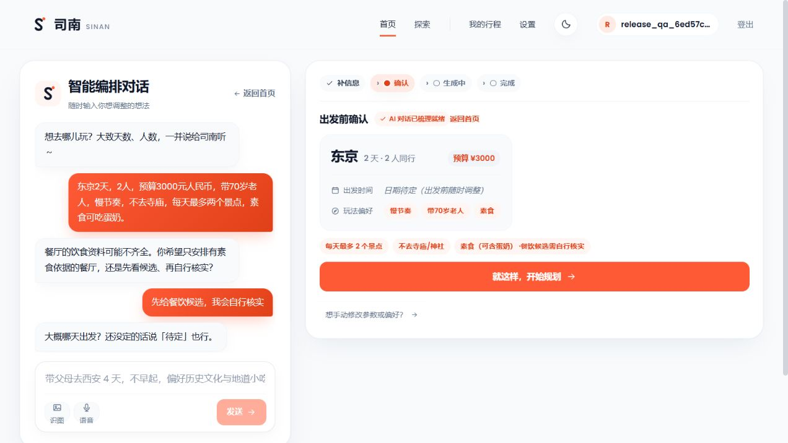

# 内容约束 P1 修复与复验 — 2026-10-11

**景点上限、寺庙/神社排除和饮食证据取舍已接入结构化需求、生成反馈及交付检查。餐饮存在性与当前菜单的证据覆盖仍不足，不能宣布全部内容 P1 已消除；公开上线结论仍为 NOT READY / NO。**

本文接续[首轮上线验收](release-audit-2026-10-11.md)与[多日交付修复](release-p1-fix-2026-10-11.md)。旧失败证据保留。本轮仅评价此次变更，不重新评分整个产品。

## 修复及边界

| 原问题与根因 | 此次修改 | 验证 |
|---|---|---|
| “每天最多两个景点”只有软偏好，没有契约字段 | 增加 `maxAttractionsPerDay`；DayPolicy 取用户上限与既有上限的较小值，最终尝试、落库及编辑校验继续阻断违例 | mock 最终尝试仍超限时抛错；真实完成样本未超 2 个 |
| “不去寺庙”缺受控类别；真实模型用 `set` 提取时被应用器拒绝 | 增加 `temple` 类别及中英日名称判据；单条排除 `set` 采用 upsert，保留其它排除项 | 多语言排除回归；自然语言真实提取及落库核验 |
| 餐厅名称/坐标被误当成素食可用性依据 | 增加 `dietaryRequirement` 与 `diningEvidencePolicy`；饮食依据独立存入已有 `factEvidence` 字典，仅使用实际外部标签，模型不能自报证据 | 外部取数→证据票→字段证据→交付及持久化测试；严格模式真实阻断 |
| 品牌名称与具体分店互相包含，可能错误背书分店 | 身份校验保留分店/括号信息；英文分店同样不能继承品牌或另一分店的证据；票据校验同时匹配名称和 provider | 中英分店、借用 external ID、伪 provider 回归 |
| 事实不足没有明确产品取舍 | 饮食要求先让用户点选“只安排有饮食依据的餐厅”或“先给餐饮候选，我会自行核实”；模型不能代选，饮食变化/证据取舍变化须重确认 | mock 与真实多轮策略变更复验；确认卡截图 |
| 首页完成预览与详情泛化核实提示不足 | 两处均消费逐餐 `DIETARY_EVIDENCE_REVIEW`；阻断态明确显示行程未完成；酒店价格标签改为每间每晚 | 生产前端真实创建、详情、刷新及 390px 手机复验 |

没有增加数据库迁移、地点语料库或新依赖。生成契约已从 schemas 导出，包含前端生成类型。原无结构化约束的已保存行程不反推用户没说过的要求；此次硬检查针对对话入口产生的结构化需求和显式携带同一结构的 API 调用。

实现位置：[需求契约](../../travel-agent-python/app/schemas/trip_requirements.py:94)、[确定性检查](../../travel-agent-python/app/agent/generation/rules/constraint_checks.py:130)、[字段证据工厂](../../travel-agent-python/app/agent/generation/output/facts.py:34)、[身份匹配](../../travel-agent-python/app/agent/core/poi_identity.py:142)、[告警展示](../../travel-frontend-react/src/react-app/itinerary/TripBadges.tsx:42)。

## 外部饮食证据的实际含义

Nominatim 请求增加 `extratags=1`，将对应 OSM 实体页作为来源链接。只有 `diet:vegetarian` / `diet:vegan` 的 `yes` 或 `only` 才产生正向字段证据；纯素标签可支持素食，素食不能反推纯素。缺失或 `limited` 不算已证明。字段标 `observed`，新鲜度保持 `unknown`，保留出发前复核要求。**这证明取回了外部饮食标签，不证明实时菜单、营业状态或无交叉污染。** 参数及标签口径依据 [Nominatim Search](https://nominatim.org/release-docs/latest/api/Search/)、[OSM diet 标签](https://wiki.openstreetmap.org/wiki/Key%3Adiet%3A%2A)。

## 真实模型复验

输入：东京 2 天、2 人、3000 元人民币、70 岁老人、慢节奏、不去寺庙、每天最多两个景点、素食可吃蛋奶。先经过真实 `/clarify`，再使用其返回的完整需求生成；没有手工补写遗漏字段。候选模式必须明确选择“我会自行核实”，否则严格处理。

| 样本 | 实际结果 | 时间 | 景点数 / 预算 |
|---|---|---:|---|
| 候选模式 id=10 | COMPLETED / READY_WITH_WARNINGS，逐餐不能确认饮食要求 | 32.70s | 2、1 / 2200 元 |
| 同题候选 id=11 | COMPLETED / READY_WITH_WARNINGS | 24.55s | 2、1 / 1910 元 |
| 严格模式 id=12 | FAILED / BLOCKED，餐厅缺饮食依据，不冒充完成 | 60.92s | 不计作成功样本 |
| 浏览器实际创建 id=13 | 完成；四项结构化要求确实落库，详情及刷新保留逐餐告警 | 未单独计时 | 2、1 / 1880 元 |
| 最终代码候选 id=14，首次 | 第 1 天成功；第 2 天先有排除类别违例，随后有重复点过滤导致无景点，最终 FAILED | 68.99s | 原失败结果保留 |
| id=14 显式重试第 2 天 | COMPLETED；第 1 天 items 完全相同 | 18.78s | 2、2；仍须核实餐饮 |
| 最终严格模式 id=15 | FAILED / BLOCKED，饮食依据缺口仍在 | 56.88s | 不计作成功样本 |

候选模式的完成是“带明确待核实餐饮的排程交付”，不能作为“素食旅行全部事实已验证”的通过证据。最后一次候选生成仍需显式重试，未达到稳定一次完成的目标。id=14 重试后的都厅南展望室与第 1 天都厅展望室还存在同一建筑名称变体的重复风险，未将其计作内容质量全通过。

证据：[真实提取](release-content-p1-fix-2026-10-11/content-live-clarify.json)、[第一轮候选](release-content-p1-fix-2026-10-11/content-live-candidate-0.json)、[重复候选](release-content-p1-fix-2026-10-11/content-live-candidate-1.json)、[最终候选初次失败](release-content-p1-fix-2026-10-11/content-final-live-candidate-0.json)、[重试前后](release-content-p1-fix-2026-10-11/content-final-retry.json)、[最终严格模式](release-content-p1-fix-2026-10-11/content-final-live-strict-0.json)、[浏览器生成及落库需求](release-content-p1-fix-2026-10-11/content-browser-trip.json)、[取舍变更](release-content-p1-fix-2026-10-11/content-policy-switch.json)。

## 用户界面复验

生产构建实际登录、创建 id=13，确认卡展示数量、类别、饮食及候选取舍；打开详情并刷新后逐餐告警仍在。手机视口 390×844，documentWidth=382，没有横向溢出。严格模式页面显示饮食未核实明细及未完成状态。这些截图证明页面与保存结果一致，不证明餐厅存在或菜单适用。

手机截图：[390px 饮食告警](release-content-p1-fix-2026-10-11/mobile-dietary-warning.png)；严格模式：[未完成及饮食依据缺口](release-content-p1-fix-2026-10-11/strict-blocked.png)。

## 工程验证

| 检查 | 最终结果 |
|---|---|
| `scripts/check.ps1` 全门禁 | **ALL GREEN**；1768 passed、1 skipped、3 既有 warnings |
| 变更行覆盖率 | 163 / 163 行，100% |
| 四套离线行为评测 | 全部通过；体验案例 14/14、检查 20/20 |
| eval ratchet | 31 个指标在基线内，未放宽基线 |
| 针对性回归 | 98 项身份/证据/解析检查、31 项最终回归通过（有重叠，不累计为独立样本） |
| 前端 | production build、306+5 项测试、theme/ep 门禁通过 |
| 最终生产镜像 | 前后端 build 成功、均 healthy；实际健康端点 `status=up`、前端 HTTP 200 |

验证摘要：[检查日志](release-content-p1-fix-2026-10-11/checks.txt)、[生产健康响应](release-content-p1-fix-2026-10-11/content-production-health.json)。离线评测是 mock 行为检查，不计作真实菜单/外部服务验收。前端保留既有大包警告；本轮未改 bundle 门槛。

验收结束已关闭专用后端、预览及隔离容器，保留合成数据库卷和证据。原有 3306 MySQL、6379 Redis 仍运行；没有提交 Git commit 或发布应用。

首个全量回归发现来源登记和流式黄金快照两个同步缺口，已修复；没有跳过门禁。快照人工审查：只新增 14 个条目的 `factEvidence`，地点、价格、其它事件值与顺序不变；模型价格保持 `unverified/generated`。[快照审查记录](release-content-p1-fix-2026-10-11/content-snapshot-review.json)。

## 仍未闭环的发布风险

1. **P1：真实餐饮与菜单证据覆盖。** 候选中仍有缺正式名称/分店依据的餐厅，严格模式两轮均未完成。当前改善的是不把未知当成已满足，未证明能稳定产出全部有据的素食行程。下一步必须提高真实外部检索、可引用菜单资料与餐厅身份覆盖，不能靠调低门禁或改展示金额。
2. **P1：复杂多日一次完成率与地点重复。** 最终候选仍需用户重试；同一建筑名称变体且坐标缺失时仍可能跨日重复。此次没有获得稳定性全通过证据。
3. **排除类别仍是保守名称判据。** 名称含“神宫”的关联园区也可能被拒；缺少外部分类别事实时，不能宣称语义分类完整。这是可用性边界，需要真实类别证据进一步改进。
4. **预算及其它旅行事实仍为估算。** 此次成功样本在预算内，不构成实时票价、汇率、无障碍路线或菜单保证；首轮报告其它未修条目仍适用。

本轮没有重新进行整套安全红队与全设备矩阵，不以这次局部复验替代首轮完整验收。**若今天公开给真实用户，仍建议 NO。**
