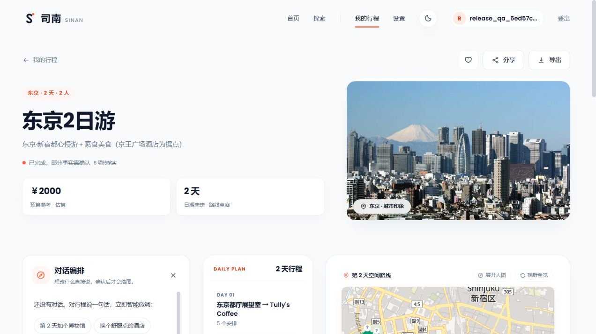

# 多日交付 P1 修复与复验 — 2026-10-11

> 后续数量、类别和饮食证据约束的修复及真实复验见[内容 P1 修复记录](release-content-p1-fix-2026-10-11.md)。本文保留本阶段结果，不追溯改写旧证据。

**交付与单日补齐的 P1 已完成针对性修复，原失败行程真实补齐成功。费用单位混用有明确改善，但本轮不宣布所有 P1 内容风险消除，也不改变公开上线 NO 的判断。**

本次接续 [首轮验收报告](release-audit-2026-10-11.md)，保留首轮原始失败证据。原基线提交为 `1a93703a271620c904af39beb98567c05f42ce72`，工作区包含上一轮已验证的修复，未提交或发布。

## 根因与修改

首轮真实轨迹的两次单日运行都显示：第二天连续三次重复输出第一天的都厅、餐厅、中央公园；去重后空日或只剩咖啡。反思只拿到泛化的缺景点反馈，最后一次采样还主动清空反馈。图出口只检查非空 items，允许咖啡单项通过，再由落库闸置 PENDING，单日补齐因此结束却没有交付。

针对这些接缝，本次修改如下：

1. 过滤后失去可游玩景点时，携被删地点名称与具体缺口进入已有有界重试；最后一次采样保留失败原因。酒店跨天沿用仍合法，到离日仍依既有 DayPolicy 判断可游玩性。
2. 把原落库硬闸迁到 Agent 的 `hard_day_issues`，图内修复、图出口、检查点续跑和业务落库共用。结构不完整、明确需求违例会参与修复；耗尽后响亮失败，不以非空咖啡列表伪装补齐。旧检查点含不可交付结果时保留研究上下文并交回补齐路径，避免恢复扫描误判已经续完。原判据与阈值未放宽，未增加兼容接口或第二套事实模型。
3. 单日提示中的时间窗口、慢游景点上限改为既有 DayPolicy 投影，模型收到的判据与验收口径一致。
4. 全部天补齐成功后清除系统写入的旧失败文案，部分交付时仍保留；其他普通行程说明保留。
5. 预算提示明确人民币 CNY/RMB、餐饮/门票每人每次、酒店每间每晚，禁止把日元等本币数字直接写成人民币。没有猜测汇率、自动缩小报价、伪造事实或改写旧成功日价格。

原单补齐实测先于旧失败文案清理补丁，因此其证据仍含旧 planNote；清理行为由补齐终态集成测试验证。本次不批量回填历史行程。

关键代码：[过滤反馈](D:/wcy/project/Sinan/travel-agent-python/app/agent/generation/content/landing.py:71)、[共享交付闸](D:/wcy/project/Sinan/travel-agent-python/app/agent/generation/content/reflect.py:43)、[最后尝试反馈](D:/wcy/project/Sinan/travel-agent-python/app/agent/generation/orchestration/trip_graph.py:155)、[费用单位](D:/wcy/project/Sinan/travel-agent-python/app/agent/generation/rules/budget.py:52)、[完成后的旧错误清理](D:/wcy/project/Sinan/travel-agent-python/app/services/day_persistence.py:207)。

## 真实模型复验

模型及需求沿用首轮。东京原输入为两天、两人、3000元、70岁老人、素食、不去寺庙、每天最多两个景点；结构化需求仍是 relaxed + 排除浅草寺/明治神宫。本次没有为了过验收而删掉原话。

| 样本 | 实际结果 | 耗时 | 估算合计 |
|---|---|---:|---:|
| 原失败行程 id=1，重生成第2天 | 第2天 SUCCEEDED，整单 COMPLETED；第1天 items 完全相同 | 51.61秒 | 9220元，保留了第1天原有高价，仍有超支告警 |
| 修复交付后、费用提示改进前，同输入新单 id=6 | 两天 SUCCEEDED，COMPLETED | 28.28秒 | 10940元，预算问题仍复现 |
| 最终费用提示，同输入新单 id=7 | 两天 SUCCEEDED，COMPLETED | 52.62秒 | 2000元 |
| 最终费用提示，同输入重复新单 id=8 | 两天 SUCCEEDED，COMPLETED | 28.50秒 | 2820元 |
| 成都三日、两人、3000元、老人慢游 id=9 | 三天 SUCCEEDED，COMPLETED，沿用两晚酒店 | 89.55秒 | 2010元 |

以上是有限真实样本，不是成功率、容量或价格准确率统计。最后三单的计时包含 HTTP 建壳及轮询观察，轮询间隔4秒；首轮补齐计时包含最后详情读取。完整 JSON 及前后对比在 [复验证据](release-p1-fix-2026-10-11/)。后台恢复扫描还处理了旧合成故障样本；它们不计入本表质量样本。

费用提示改进前的新宿御苑 cost=500 被按人民币汇总，而日本环境省公开普通票价是500日元，这支持币种混用判断；仍不能据此认定每一项错误金额的成因完全相同。最终两个新样本该项 cost=30，依然只是模型人民币估算，不是本系统取得了报价或实时汇率。[官方入园价格](https://policies.env.go.jp/national-garden/shinjukugyoen/guide/information/)

生产前端实际登录、打开 id=7、切换第2天并刷新检查：显示已完成，预算2000元、两天条目可见，地图和待核实标识保留。截图仅证明页面与真实保存结果一致，不证明餐厅真实性。

## 回归与门禁

新增回归先验证失败：最后一次反馈清空、咖啡-only 仍被返回，两项在修复前均失败。之后测试真实落地/去重步骤向图回传缺口、慢游策略入提示、不可交付末次产出拒绝，以及成功补齐后清除旧失败文案。

清理检查点的旧测试用没有时间的单景点草稿当作成功产出；它已不符合收紧后的图出口，现使用该文件既有合格计划，全部清理/续跑断言保留。另有两个旧测试原本要求最后一次清空反馈或交付时间冲突结果，已改为验证保留反馈、耗尽后拒绝硬冲突。没有放宽门禁或覆盖率基线。

| 最终检查 | 结果 |
|---|---|
| 针对性生成/恢复/交付回归 | 63 passed |
| 后端 `scripts/check.ps1` | ALL GREEN：1745 passed、1 skipped、3 warnings |
| 变更行覆盖率 | 100%，无缺失行 |
| Ruff、format、pyright、分层、规模、密钥扫描 | 全部通过，保留原门槛 |
| schema/OpenAPI/前端类型漂移 | 字节一致，产物均已跟踪 |
| 四套行为评测及棘轮 | 全部通过，31指标在原基线内；experience 14案例、20检查 |
| 最终生产后端镜像 | 构建通过；应用/MySQL/Redis健康检查通过 |

日志汇总见 [checks.txt](release-p1-fix-2026-10-11/checks.txt)。前端本轮未新增修改，沿用首轮已通过的305+5测试及生产构建。schema、SQL迁移、依赖、生产凭据均未变更。

## 仍需处理的风险

- **地点与饮食真实性仍是 P1 风险。** 新样本仍有“T's 餐厅 新宿店”“新宿华盛顿酒店 素食自助餐厅”等缺乏可靠分店依据的名称；餐厅的素食可用性没有得到证明。费用回归合理不等于这些地点已核实。
- **自然语言约束仍缺硬保障。** id=8 第1天有3个 attraction，并出现寿司店、神社等需核对的安排；虽然完整交付，也不能判定“每天最多2景点”“素食”“不去寺庙”的完整意图都被满足。没有把软偏好误报为通过的硬约束。
- **预算只做了生成提示的纠偏。** 两次同题已回到预算内，但未建立多币种报价/汇率核验闭环；旧成功日价格保持原样，id=1仍超支。下一步需要事实依据及约束落实的可靠机制，不应靠再次压低显示金额。
- **最终尝试不保证一定成功。** 提供方失败或反复不可交付时仍如实失败，保留此前成功日，允许用户显式重试；本轮改善修复闭环，不承诺任意模型输出都能生成完整行程。

**当前公开上线结论仍为 NO。** 交付缺口已完成本轮复现与修复验收；地点真实性和特殊约束的风险需要下一轮继续处理。

真实模型、浏览器和生产镜像健康验收完成后，专用服务已停止，合成 QA 数据和数据卷保留。证据链接与真实密钥匹配检查通过；文件 SHA-256 清单见 [manifest.json](release-p1-fix-2026-10-11/manifest.json)。
