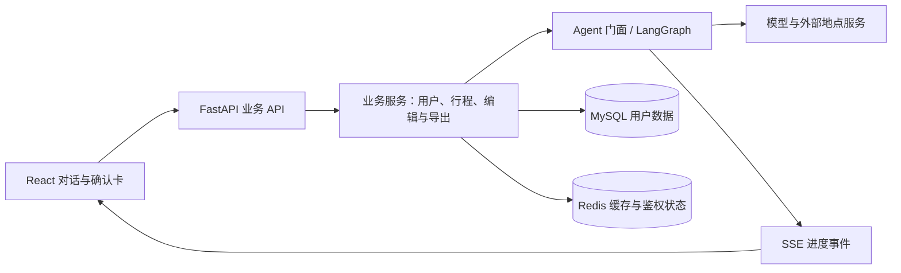

# 当前架构

司南由 React 前端与单进程 FastAPI 后端组成。LangGraph 控制需求解析、研究、生成、检查与输出流程；模型在约束内产出内容和修改提案。

地点事实来自模型知识、联网搜索和地点服务，本地不存景点语料库。估算与未核实内容带标记，地图显示不代表事实已核实。
业务服务处理行程写入、编辑范围与确认；内部 Agent 面与 MCP 不通过前端代理公开。
跨端契约以 `app/schemas/` 为单一源，迁移只追加，分层由门禁检查。

## 证据口径

- `/demo` 是合成固定样例，验证 UI 交付与确认，不证明模型质量。
- 离线测试与评测由 mock 驱动，验证约束、失败路径、契约和确定性。
- 真实模型评测受模型、输入集、预算与外部服务影响，必须记录配置与样本量。

前端围绕单人规划与编辑；协作、版本和部分后台能力保留于后端，不能把端点数量当作前端功能数量。
