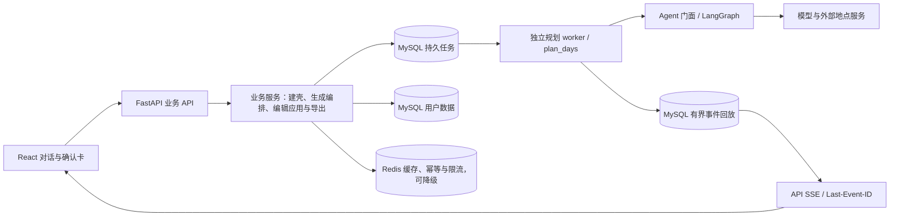

# 当前架构

司南由 React、FastAPI API 与独立规划 worker 组成。业务服务在同一事务内创建行程和 MySQL 待执行任务，再立即返回；worker 领取后在有界线程池中执行 `plan_days`；模型在约束内产出内容和修改提案，确定性规则负责验收。

一次生成的实际链路（`services/itinerary_generation.py` 的 `plan_days`）：

1. 研究：景点、餐饮、住宿三路 LangGraph 子图并行检索，按用户约束构造检索参数，模型评估证据是否充分，最多补查一轮；
2. 整段流式生成：统一图的 `stream` 分支一次生成全部天数，增量 JSON 解析逐天落库并推送预览；
3. 终检：对已落库的天跑确定性规则（时间、路线、预算、必去/排除等），违规天重置；
4. 逐日补齐：统一图的 `day` 分支只为违规或缺失的天带反馈重生成，有次数上限，仍不合格则明确标记失败。

统一图另有 `trip` 分支（parse → research → generate → reflect → format），供内部 Agent 面 `/api/agent/v1/generate` 使用，前端业务链路不经过它。离线评测默认跑上面这条业务链路（`plan_days` 在临时 SQLite 上真跑、按落库结果计分），`trip` 分支只作为 `--path graph` 的对照。

整趟规划任务以 MySQL 租约判定执行权；恢复扫描按过期租约接管，不再等待行程闲置五分钟。事件按行程在 MySQL 内分配序号，保留最近 256 帧与两小时窗口；重连任一 API 实例均可补发，缺口明确发 `resync`，终态从业务库补帧。聊天私有流仍留在原会话通道。
当前范围是同一宿主机的进程隔离，SQLite 检查点与文件目录仍需共享；没有宣称跨主机高可用或经过压测的吞吐。实现、运行和故障验证见 [规划 worker](planning-worker.md)。

地点事实来自模型知识、联网搜索和地点服务，本地不存景点语料库。估算与未核实内容带标记，地图显示不代表事实已核实。
条目费用恒按人民币存储：模型在 `cost_currency` 里声明所写数字的币种，后端按固定汇率确定性换算；`cost_currency="CNY"` 表示币种有据，`NULL` 表示未声明（旧数据或模型漏写，此时才退回按金额推断的兜底）。
业务服务处理行程写入、编辑范围与确认；内部 Agent 面与 MCP 不通过前端代理公开。会话用 HttpOnly Cookie 承载 JWT（PyJWT，HMAC 算法按密钥长度定档且解码只认该档，必须带 exp/sub/jti，登出按 jti 吊销）。
跨端契约以 `app/schemas/` 为单一源，迁移只追加，分层由门禁检查。

## 证据口径

- `/demo` 是合成固定样例，验证 UI 交付与确认，不证明模型质量。
- 离线测试与评测由 mock 驱动，验证约束、失败路径、契约和确定性；评测默认走业务层产品路径，LLM HTTP 出口有哨兵，任何真实调用直接判错。
- 真实模型评测受模型、输入集、预算与外部服务影响，必须记录配置与样本量。

前端围绕单人规划与编辑；协作、版本和部分后台能力保留于后端，不能把端点数量当作前端功能数量。
