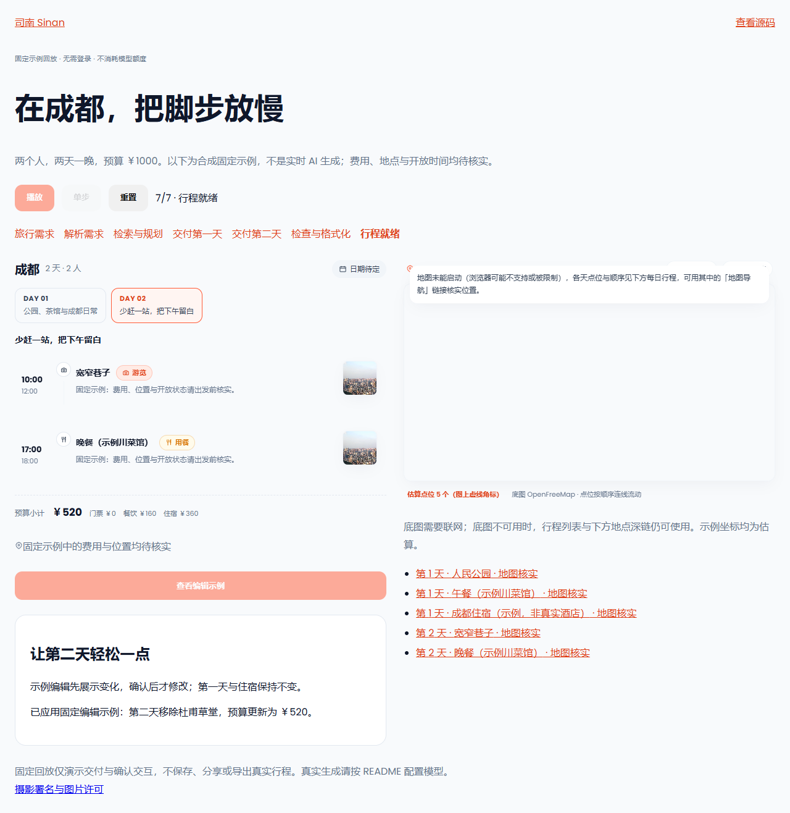

> 历史记录：以下为 2026-10-11 的旧演示验收；其中暂停/单步、预算和截图不能作为新版页面证据。2026-10-16 完整页面展示的交互与部署说明见 [Vercel 展示说明](vercel-demo.md)。

# 开源预览验收记录

日期：2026-10-11。代码基准：`ab3eb80`，本批实现与补充修复截至 `5fef88e`。
分支：`codex/open-source-preview`。本记录对应本地验收，尚未推送或运行远端 GitHub Actions。

## 交付内容

- MIT 代码许可、第三方资源说明、照片转换记录；贡献、行为、安全文档与 Issue/PR 模板。
- PDF 使用随仓的 OFL 静态中文字体，固定上游提交、400 字重及 SHA256；转换工具只在开发依赖中。
- 独立 Compose 初始化与运行诊断；生成缺失配置，保留现有配置与数据权限，模型 key 默认空。
- 匿名 `/demo` 固定示例回放，复用行程、地图与编辑确认组件，确认后只调整第二天。
- 中文 README、英文入口及公开架构、配置、开发、排障文档；教学笔记仍被忽略。
- Node 22 构建环境、`npm ci`，以及无需密钥的 PR 安装与浏览器验收。

## 验收结果

| 项目 | 结果与边界 |
| --- | --- |
| 后端完整 `scripts/check.ps1` | ALL GREEN：1738 项通过、1 项 Linux 权限测试在 Windows 跳过、3 项既有警告；Ruff、类型、分层、规模、秘密扫描、契约漂移通过；2 行变更应用代码覆盖率 100% |
| 四套离线评测与棘轮 | agent/research/editing/experience 均通过；31 个棘轮指标在基线内；体验题集 14 例、20 项检查通过，未变更基线 |
| 前端构建、单测、外观门禁 | 生产构建通过；293 项 Vitest、5 项交付检查通过；theme/EP 违规均为 0 |
| Linux 安装单测 | 一次性 Python 3.12 容器、UID 1001：9 项通过，包含配置缺失、保留配置、脱敏与已有目录权限错误 |
| 重复初始化与新目录权限 | 新建 Linux 配置为 0600 且归属宿主模板用户；UID 1001 可读；新 data 归属 UID 1000 且可写；重复初始化前后配置逐字节相同 |
| 全新 Compose 启动 | 独立空配置、空数据副本：MySQL、Redis、后端、前端均 healthy；doctor 检查配置、依赖、`/demo` 与业务代理通过，模型 key 为空 |
| 匿名浏览器回放 | 直接访问、刷新、自动播放、暂停、单步、重置、编辑前预览与确认通过；预算 570→520，第一天和住宿保留；移动端无横向溢出；零业务 API 请求 |
| 地图 | 无 WebGL 与底图请求失败时仍保留行程与深链；本地空样式下真实 MapLibre 初始化、6 个点位及完整视野通过；未验证在线瓦片服务可用性 |
| PDF | PDF/退役回归 19 项通过；长中文示例生成 8 页，提取到中文与金额符号，存在嵌入 TrueType 字体；首尾页渲染目检通过 |
| 构建分发 | 后端保留字体、OFL、MIT 与第三方说明；前端 nginx 保留 MIT、第三方说明、照片署名及前端字体许可；运行后端无 fontTools、无镜像内 `.env` |
| 当前文件秘密扫描 | 通过，输出不回显匹配内容 |
| Git 历史扫描 | 检出 1 项已人工判读的 E2E 固定测试口令；未发现真实密钥，扫描器未降低规则或添加宽泛豁免 |
| GitHub 私密漏洞报告 | 已启用，并通过 GitHub API 读取确认 |

Windows 的完整后端套件会跳过 1 项 Linux UID 权限测试，该项已在上述 Linux 容器中通过。
离线题集、mock 结果与测试数量都不构成真实模型质量结论。

## 隔离方式与证据

Docker 验收使用独立副本、项目名 `sinan-preview-audit-01a12958`、独立容器名、端口和数据卷。
没有运行主工作目录的初始化或启动命令，没有改写当前开发者 `.env`、已有容器或业务数据。
初次启动使用仓库 Dockerfile；Docker Hub 出现的临时 TLS 握手超时通过重试处理。
测试期间不调用真实模型、nightly、生成压测或付费 API。

浏览器截图由固定回放自动生成；地图截图使用本地空样式，空白底色不是实际在线底图。
截图内照片来自随仓成都封面（George N，CC BY 2.0），完整来源见 [照片署名台账](../../travel-frontend-react/src/assets/img/CREDITS.md)。

[移动端截图](preview/demo-mobile.png) · [地图点位截图](preview/demo-map.png)

字体来源与校验值见 [provenance.json](../../travel-agent-python/app/resources/fonts/provenance.json)。
离线体验报告见 [experience_report.json](../../travel-agent-python/tests/agent_eval/report/experience/experience_report.json)，记录提交与数据集哈希。
历史扫描命中位于提交 `52568235b7854ca71bdd72063516ca7c93336ef9` 的 `travel-frontend-react/e2e/golden-path.mjs`，规则为 credential-assignment；此处不转录口令值。

## 复跑入口

首次启动和诊断按 [README](../../README.md)；回归命令按 [开发指南](development.md)。
浏览器入口为前端目录的 `npm run e2e:demo`，可指定 `E2E_BASE_URL`；CI 使用 Playwright Chromium。
历史秘密扫描在根目录执行 `powershell -NoProfile -File scripts/check-secrets.ps1 -History`，已知测试口令仍会被报告并返回非零，需人工判读。

## 尚未执行与后续范围

- 本批没有推送、部署或创建正式 Release，因此远端 PR CI 与远端全新安装验收尚未执行；已接入无密钥 PR 工作流。
- 没有运行真实模型评测，尚无新增的真实模型质量或生产 SLO 结论。
- 版本化镜像、正式 Release、更大规模真实评测和用户反馈闭环属于后续批次。
- MapLibre 构建产物约 1.06 MB，现有大 chunk 警告保留，没有抬高阈值掩盖。
