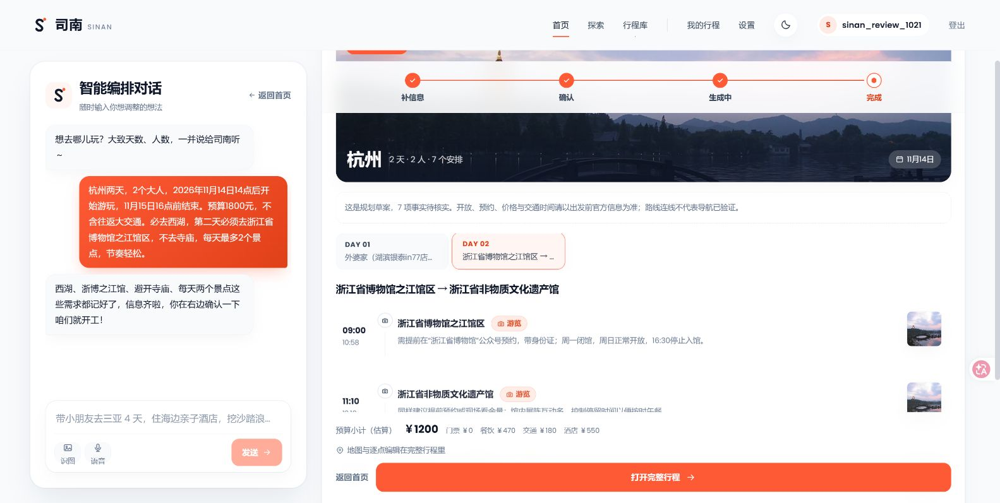
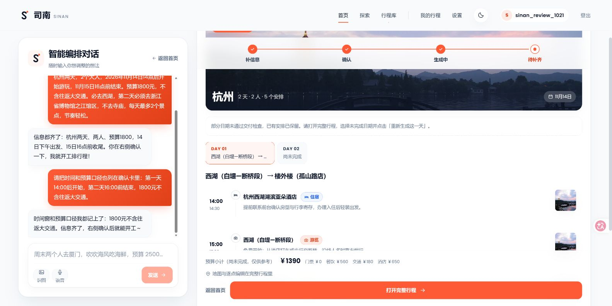
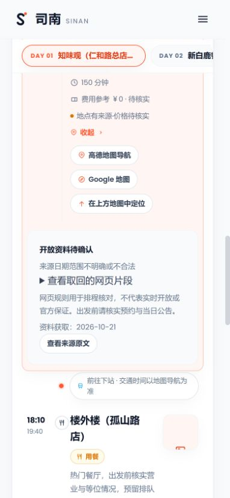

# 一次真实产品验收：确认要求，交付草案，再局部修改

验收日期：2026-10-21。面向已选好城市、准备国内单城 2–3 日周末或短假的人。Sinan 的目标是把想法整理成可核对、可继续修改的行程草案，而不是代替订票、导航或出发前的事实核查。

## 如何体验

- [公开交互演示](https://sinan-demo.vercel.app)：固定成都两日合成样例，不调用模型，不代表模型生成质量。输入“把第二天安排松一点”，查看差异并确认，费用小计从 1180 变为 1080 元；刷新后仍保留本标签页内的修改。
- 真实模式：按 [开发说明](development.md) 在本机启动前后端。以下验收使用独立测试账号、实际模型和 MySQL，通过浏览器操作业务层 `plan_days` 路径。
- 当前没有对外开放的真实模型试用服务。公开演示不连接本次验收数据库，也不包含真实账号、私有行程或模型凭据。

本轮对外交付范围为“公网固定演示＋本地真实运行案例”。付费托管尚不具备条件，真实模型公网试用另行安排；这不影响查看交互和复现本地案例，但不能称为已上线的真实旅行规划服务。

固定演示已于本日更新，公网首页和详情直达、刷新均已复查；[桌面首页截图](preview/public-home-20261021.jpg)与[手机详情截图](preview/public-mobile-20261021.jpg)来自该公开部署。案例、README 和相关修复随发布分支提供。

版本边界：真实模型验收使用当时的本地集成工作树，其中也有独立进行、尚未发布的搜索与研究修改。首批发布提取产品交互、约束、编辑保存、任务账本及行程库的相关改动，搜索与研究修改随后经 PR #9、#10 独立审阅。案例一、二仍是当时的集成运行记录；本轮新提交的真实复测见文末“收尾复核”，离线回归以对应 GitHub CI 为准。

## 案例一：普通两日规划与局部修改

需求为两位成人在 11 月 7–8 日去杭州，预算 1500 元，希望去西湖和浙江省博物馆、节奏轻松。实际生成两天、11 个安排，最终落库为 `COMPLETED`；质量状态是 `READY_WITH_WARNINGS`，仍有 11 项事实待核实。

随后输入“只移除第二天的小河直街，其他地点、时间、第一天和酒店都保持不变”。浏览器先展示移除差异，确认后保存，刷新可见第二天减少一项。验收也暴露了一个真实缺陷：未修改日期的地点和时间保留了，但主题与实用提示被清空。本轮已修复，并通过包含主题、备用方案及实用提示的事务应用回归。

修复后又在从公开杭州规划复制的独立行程上实测：移除第二天“河坊街”，查看差异、确认、刷新，再读取服务端结果。第二天从 4 项变为 3 项，第一天完整内容逐字段一致，主题保留。这里的原始路线来自编辑模板，编辑提案来自真实模型；不把模板复制当作模型规划成功。

复制路线的条目没有定价，编辑后系统只产生 180 元交通估算；详情已明确标为“部分费用估算 · 尚有条目未计价”，不能理解为两个人整趟只需 180 元。用户填写的预算目标也不会再被当作系统估算总额。

## 案例二：指定日期、必去日与到离时间

输入原文：

> 杭州两天，2个大人，2026年11月14日14点后开始游玩，11月15日16点前结束。预算1800元，不含往返大交通。必去西湖，第二天必须去浙江省博物馆之江馆区，不去寺庙，每天最多2个景点，节奏轻松。

这次验收不是一次成功截图：前两次生成均仅交付第一天。第一轮暴露了时间窗提取缺失、单边时间窗未检查及必去名称被地理解析别名覆盖的问题；补齐重试还暴露了 Token 预留释放未同步到任务累计列的问题。第二轮揭示逐日修复中的额外备选搜索挤占后续日期预算。失败结果保留为 `PARTIAL`，没有改成成功。

本轮修正上述接缝后，以相同输入再次从浏览器创建新行程，两天均落库为 `SUCCEEDED`，整趟 `COMPLETED`，没有阻断项：

| 要求 | 实际落库结果 |
| --- | --- |
| 第一天 14:00 后开始 | 首项 14:00，西湖 15:10–17:40 |
| 第二天指定之江馆区 | 浙江省博物馆之江馆区 09:00–10:58 |
| 第二天 16:00 前结束 | 最后一项 14:00 结束 |
| 每天最多两个景点、不去寺庙 | 第一天 1 个景点，第二天 2 个；未安排寺庙 |
| 预算 1800 元，不含城际交通 | 全体同行人估算 1200 元：餐饮 470、住宿 550、市内交通 180 |

完整交付仍不等于旅行事实已核实：质量状态为 `READY_WITH_WARNINGS`，7 项事实待复核，4 个点位没有坐标。页面中的预约建议、分店名称与营业状态不能据此当作官方规则；例如截图中的“需提前预约”属于模型建议，本轮没有取得足以确认该要求的官方正文。最后补充了生成提示约束，要求无本次来源的预约、闭馆与寄存信息写成核实项；这项提示修改只完成相关离线检查，尚未再次用真实模型验证效果。

地图展示点位顺序及检索入口，不是交通路线优化的证明。上述一次成功也不能证明成功率提升；各次检索缓存与外部服务状态不完全相同，没有据此发布性能、费用降幅或优于通用模型的结论。

## 两项可以核查的产品能力

1. **要求与交付状态可核对。** 确认页展示后端实际提取的约束；确定性规则检查时间窗、必去、排除与密度；失败日期与已交付日期区分，保留成功内容并给出补齐入口。实跑与失败截图对应前后端同一份行程。
2. **局部修改需确认，未改内容保留。** 自然语言生成服务端草稿，前端展示差异，用户确认后执行归属、版本与内容检查并事务保存。浏览器刷新与服务端复读证明本次未修改的第一天保持一致；并发、取消和版本冲突的更广范围由现有测试覆盖，未在本轮逐项浏览器重演。

对应源码：[需求提取](../../travel-agent-python/app/agent/editing/clarify.py)、[约束规则](../../travel-agent-python/app/agent/generation/rules/constraint_checks.py)、[业务交付](../../travel-agent-python/app/services/itinerary_generation.py)、[确认应用](../../travel-agent-python/app/services/itinerary_plan_apply.py)、[预算持久化](../../travel-agent-python/app/services/planning_tasks.py)。

## 其他已检查项与边界

- 桌面和手机尺寸实际操作了创建、查看、编辑、刷新及行程库复制；手机详情先显示行程，公开发布面板移至内容之后。
- 真实分享链接可只读访问；返回数据不包含聊天记录、账户身份和账目。公开行程发布预览展示白名单，复制不继承私人日期、预算及预订。本轮未实际公开测试行程。
- 中文 PDF 已通过浏览器生成并下载，检查了三页文档的首页；尚未完整逐页检查，费用列的窄列换行与单位说明仍可改进。
- 全量回归交 CI。本轮采用根目录日常验证入口和相关测试，未执行本地全量；请查看发布提交对应的 CI，旧提交的成功结果不能代替本次验证。
- 历史任务中已被旧逻辑累加过高的 Token 列尚未回填；新任务与后续写入已修复。旧失败行程的自动恢复不能据此宣称已完成。
- 录屏尚未制作；本次交付截图与案例，不声称已完成真人旅行验证。

## 收尾复核：开放资料与研究取舍

PR #9 已合并搜索、研究降级与取消保护；[PR #10](https://github.com/wabcyyyy/Sinan/pull/10)继续完成开放规则、来源展示与逐日修复反馈。下面是这一批的新运行，不能与上文集成工作树的历史截图混为同一次请求。

在 `1323090` 上，用相同 P01「杭州两日、两人、人文美食、2026-11-02」及总限额，分别在独立进程、临时 SQLite 中真实运行业务层 `plan_days`。直接检索臂保留相同生成与修复能力；研究臂使用当时的模型查询规划、评估及补查。调用计数包含失败 HTTP 尝试：

| 单次运行 | 最终交付 | 耗时 | 模型 HTTP 尝试 |
| --- | --- | --- | --- |
| 直接检索＋相同修复 | 完整 | 79.36 秒 | 11 |
| 当时研究流程 | 部分完成 | 95.72 秒 | 16 |

研究臂第二天晚餐过晚，逐日修复又受到 Token 限额约束，未完整交付。这个反例不能证明直接检索普遍更优，但不支持“多次模型研究必然更可靠”。因此默认查询规划改为沿用用户需求参数，省去三域独立的模型改写调用；实际候选评估和有界补查保留。`65625c8` 同题新运行完整交付，95.96 秒、17 次 HTTP 尝试，说明总消耗仍受搜索失败与外部状态影响，**没有据此发布速度、费用或成功率提升百分比**。供应商缓存、网络和模型随机性未受控；模型总费用未估算，搜索小计不能当作总费用。

固定“预留一半 Token 给修复”的实验未纳入：它会拒绝原本在总限额内的正常请求，缺少净交付收益证据。保留既有总预算和明确失败状态。

开放资料现在携带网页片段、链接、获取时间及可解释规则。明确星期、时段、停止入场或完整日期范围可用于一致性检查；季节、历史临时公告、实体不符、来源冲突或日期不全保留 unknown。票据校验防止模型自行编造来源，但网页本身不等于官方保证。离线回归覆盖闭馆冲突进入逐日修复及原始来源保存；本次真实网页取证未获得足以宣称“营业事实已核实”的来源。

真实页面验收使用独立 SQLite 用户库、真实 FastAPI API、模型与外部检索，跳过服务启动时的 MySQL 迁移和后台任务；城市字典不可用时走已有外部兜底。它验证本地交互及业务交付，不证明生产部署或完整 MySQL 环境已验收。原始成功、部分完成、调用记录和服务端详情保留在本地证据目录，未上传私人数据或凭据。

2026-10-21 深夜至 22 日凌晨，又从真实页面输入案例二相同复杂需求：最终 `COMPLETED`、7 个安排，首日 14:00 开始，次日最后一项 15:55 结束，第二天包含指定之江馆区，未安排寺庙，费用估算 1620 元。仍有 7 项事实待核实、5 个条目缺坐标；时间窗成立不等于餐厅营业、道路通行或交通时间已核实。

随后提出只移除第二天外婆家，酒店及其他内容不变。首次误入酒店候选、再测试发现修改日的元数据被清空，均保留了失败记录并修复。恢复本次测试行程的编辑前版本后，用同一句话重新生成提案，确认、刷新并复读服务端：第二天 3 → 2 项；第一天完整对象一致，第二天剩余条目、主题、备用方案、拍照点和提示均一致。过时的日摘要改为提示按实际安排查看，迷你路线不沿用旧路径。手机 390×844 视口实际展开资料与来源入口，页面宽度与滚动宽度均为 382，无横向溢出。

这仍是一组本地案例；部分实用提示存在模型沿用旧路线的表述，用户需要按实际当天条目复核，不把说明文字当作已验证交通建议。当前可对外发布的是作品展示与可复现的本地运行能力；真实模型公网服务尚未部署，录屏与真人旅行效果验证尚未完成。
